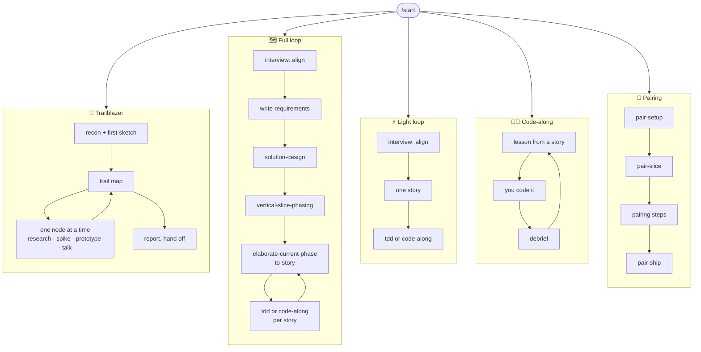
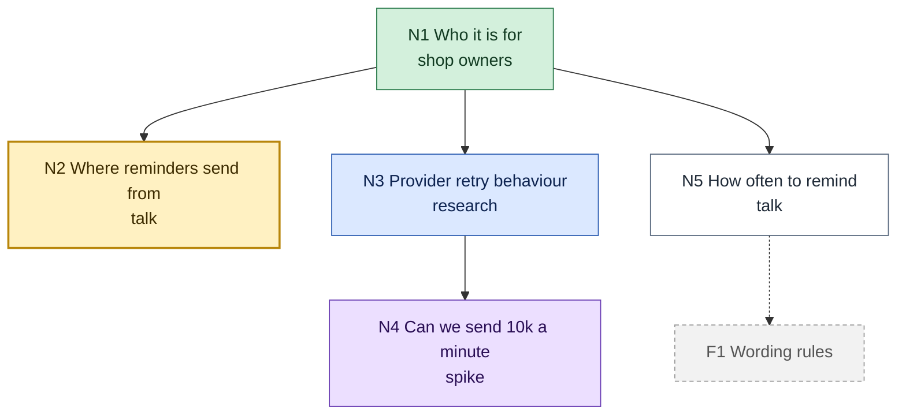
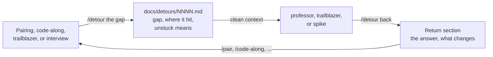
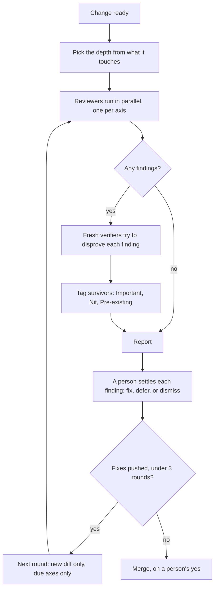
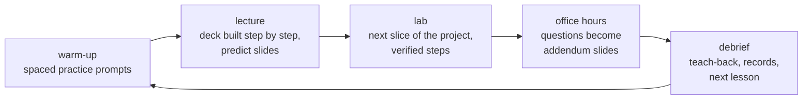

<h1 align="center">Skills</h1>

<p align="center">
  <b>Agent skills for building software the way people actually build it.</b><br/>
  Explore a foggy idea, plan a feature, build it yourself, ship a small change,<br/>
  or pair with the agent,
  with stories a person can see and pictures that live in the docs.
</p>

<p align="center">
  
  
  
</p>

<p align="center">
  <a href="#-install">Install</a> ·
  <a href="#-quick-start">Quick start</a> ·
  <a href="#-the-five-modes">The five modes</a> ·
  <a href="#-finding-things-out">Finding things out</a> ·
  <a href="#-stories-people-can-see">Stories</a> ·
  <a href="#-reviewing-a-change">Review</a> ·
  <a href="#-pictures-in-the-docs">Pictures</a> ·
  <a href="#-skill-reference">Reference</a>
</p>

---

## ✨ What this is

A set of skills (folders with a `SKILL.md` that your coding agent loads on
demand) organised as **one small kernel and five ways of working**:



Every mode reads and writes the same files in your repo, so you can switch
modes per story without losing anything.

**What's new in 2.4:** `professor`, which teaches any subject one lesson at a
time: a lecture deck built step by step, then a lab that builds the next slice
of a real project, then office hours and a teach-back, with spaced practice
instead of a quiz. It stands on three new kernel skills, `learner`, `slides`,
and `fact-check`.
**In 2.3:** `detour`, for when you hit something you don't
understand mid-flow: it pauses the work, sends the gap to `professor` or
`trailblazer` in a clean context, and brings the answer back to where you
stopped.
**In 2.1:** `trailblazer`, research you do together around a living
map, plus `spike`, `prototype`, and `research` skills any mode can call.
**In 2.0:** no dependency on any other skill repo, stories written for people
(with agent tasks inside them), and Mermaid diagrams everywhere, validated before
you see them, with a local viewer. See the [changelog](CHANGELOG.md).

---

## 📦 Install

**Prerequisites:** an agent that loads `SKILL.md` skills (Claude Code, Codex,
Cursor, and others). Python 3 for the diagram tools. Node.js (for `npx`) if you
want diagrams validated; everything else works without it.

**Option A: the skills CLI** (copies the skills into your agent's skills folder)

```bash
npx skills@latest add robjsliwa/skills            # this project only
npx skills@latest add robjsliwa/skills -g         # or for every project (user folder)
```

Update to the latest release, or to a specific one. Releases are git tags
named by version (`2.2.0`, no `v`); see the [changelog](CHANGELOG.md) or
[releases](https://github.com/robjsliwa/skills/releases).

```bash
npx skills@latest update                          # every installed skill, to the latest on main
npx skills@latest update tdd detour               # just these skills
npx skills@latest update -g                       # only the global installs

npx skills@latest add robjsliwa/skills#2.2.0      # pin every skill to the 2.2.0 release
npx skills@latest add robjsliwa/skills#2.2.0 --skill tdd   # pin one skill
npx skills@latest add robjsliwa/skills            # unpin: back to the latest
```

A pinned skill stays pinned: `update` checks it against its own tag, so it only
changes when you re-run `add` with a newer tag, or without one. `npx skills
list` shows what is installed.

**Option B: clone and link** (edit the skills in place, pull to update)

```bash
git clone https://github.com/robjsliwa/skills.git
bash skills/scripts/link-skills.sh      # symlinks every skill into ~/.claude/skills/
```

Update to the latest, or check out a specific release, then re-link so new
skills are picked up (existing links follow the checkout on their own):

```bash
git -C skills pull                                # latest
git -C skills fetch --tags && git -C skills checkout 2.2.0   # a specific release
bash skills/scripts/link-skills.sh
```

Restart your agent (or start a new session) so it picks the skills up.

> **Upgrading from 1.x?** 2.0 no longer needs `mattpocock/skills`. If you
> installed it only for these skills, remove it: its `tdd` has the same name
> as ours and would shadow it. Then run `/repo-setup` once per repo; it moves
> `docs/agents/issue-tracker.md` into the new profile and offers to split an
> old glossary-style `CONTEXT.md` into `GLOSSARY.md` plus a real system-context
> page.

---

## 🚀 Quick start

In the repo you are working on:

```
/repo-setup      # once per repo: tracker, test commands, docs layout, diagrams
/start           # tells you which mode fits what you want to do, and the first command
```

That's it. `/start` reads what is already in the repo (a trail in progress, a
plan, an open lesson, an active pairing slice) and points you at the next step. You can
also skip it and call any mode directly.

---

## 🧭 The five modes

| | Mode | Pick it when | Start with |
|---|---|---|---|
| 🥾 | **Trailblazer** | Fog. The idea is big or vague and nobody can yet list the questions. | `/trailblazer <the idea>` |
| 🗺️ | **Full loop** | The architecture is the hard part. A wrong call now means a rewrite later. | `/interview` then `/write-requirements` |
| ⚡ | **Light loop** | One coherent change, no real design choice. You could open the editor now. | `/light <the change>` |
| 🧑‍💻 | **Code-along** | A story exists and you want to write the code yourself and understand every line. | `/code-along <story>` |
| 🤝 | **Pairing** | The spec is clear enough to start; you want to build one small piece at a time, together. | `/pair-setup`, then `/pair-slice` |

Judge by weight, not size: a two-line change that decides the tenancy model is
full loop; a big mechanical change is light. If you can't list the open questions
yet, it's trailblazer, whatever the size.

### 🥾 Trailblazer

Research you do together, for when the first job is finding the way. The agent
reads the code and docs before asking anything, opens with **one** question and a
first sketch, then draws a **trail map**: a Mermaid tree of the unknowns, coloured
by state, that it redraws after every decision.



White is open, yellow is the question now, blue is an agent reading, purple is
a spike or prototype running, green is decided, grey is fog. With the docs viewer
running (it starts with the first map), you watch it change as you talk. Then it works **one node at a time**:

- It recommends two or three nodes to tackle next. **You pick.**
- Facts are fetched, never asked: research and spikes run in the background while
  you talk about something else, and their results arrive in the next playback.
- Every fork is shown as small diagrams side by side, with what each option gains
  and gives up.
- After each decision it plays back where things stand in about 150 words, with
  the redrawn map.
- It ends with a `report.md` and hands off to the right loop.

```text
/trailblazer invoice reminders for small shops
# one question and a sketch; then the first map; then "which node next?"
/trailblazer                     # tomorrow: a playback of where we are, then carry on
```

Steer it in plain words: "zoom out," "go deeper," "park it," "that's out," "look
it up," "spike it," "show me," "ask Dana," "you decide." Everything lives in
`docs/research/<topic>/` as files, never tickets, so `/clear` costs nothing.

### 🗺️ Full loop

One feature, from idea to shipped code, one artifact per step. Each artifact is
a file under `docs/planning/<feature>/`, so you can `/clear` after any step and
the next skill picks up from disk.

| Step | Run | You get |
|---|---|---|
| 1. Align | `/interview` | shared understanding; `GLOSSARY.md`, `CONTEXT.md`, ADRs as you go |
| 2. Requirements | `/write-requirements` | `requirements.md`: the what and why, with a context diagram and the user journey |
| 3. Design | `/solution-design` | `design.md`: the how, with C4 container and behaviour diagrams; `CLAUDE.md`; ADRs |
| 4. Phase | `/vertical-slice-phasing` | `phases.md`: build order, walking skeleton first, with a story map |
| 5. Stories | `/elaborate-current-phase` | stories for this phase only, each one a change a person can see |
| 6. Build | `/tdd` or `/code-along` | the code, one story per session; then `/review-change` and `/pr` |
| 7. Next phase | `/elaborate-current-phase` | the next phase's stories, re-derived from the real code |

```text
/interview align on invoice reminders
/write-requirements                 → docs/planning/invoice-reminders/requirements.md
/clear
/solution-design docs/planning/invoice-reminders/requirements.md
/clear                              → design.md, CLAUDE.md, docs/adr/0004-*.md
/vertical-slice-phasing docs/planning/invoice-reminders/design.md
/clear                              → phases.md
/elaborate-current-phase docs/planning/invoice-reminders/phases.md
/clear                              → stories/01-01-owner-sees-overdue-invoices.md, ...
/tdd docs/planning/invoice-reminders/stories/01-01-owner-sees-overdue-invoices.md
/clear                              # one story per session; repeat until the phase is done
/elaborate-current-phase ...        # then the next phase, against the code you now have
```

Lost? `/start` reads `docs/planning/` and names the next step.

### ⚡ Light loop

A short align interview, one story (its tasks carry the small design), then
build. No requirements, design, or phases documents. If the change turns out
heavier than it looked, it tells you and hands over to the full loop.

```text
/light let owners resend an invoice email
# a few questions, a picture to correct, then one story to approve
/tdd docs/planning/resend-invoice/stories/01-01-owner-resends-an-invoice.md
```

### 🧑‍💻 Code-along

For any story from either loop, when you want to write it yourself. Each story
becomes a **lesson**: who it is for and the demo you will perform, a picture of
where it sits in the code you already have, only the ideas that are new to you,
then RED to GREEN steps you type into your own editor. Every code block in a
lesson comes from a reference solution that was actually built and run. When
you finish, a **debrief** looks at what you built, asks about anything you did
differently, and records what you now know. Only then is the next lesson written,
against the code you actually wrote.

```text
/code-along docs/planning/invoice-reminders/stories/01-01-owner-sees-overdue-invoices.md
# build it in your editor, at your pace; change what you think should change
/clear
/code-along           # debriefs 01-01; you commit; it writes the next lesson
```

`tdd` and `code-along` mix freely, story by story: delegate the wiring, build the
core yourself.

### 🤝 Pairing

The planning loop decides a whole feature up front. Pairing decides one small
piece at a time, with you at the keyboard as much as the agent. Every piece goes
through a branch and a PR whose body is the journal of how and why it was built.
State lives in `docs/pairing/`, so `/clear` costs nothing.

| When | Run | Does |
|---|---|---|
| Once per repo | `/pair-setup` | extends `/repo-setup` with stack, style, git flow, PR policy, pairing habits |
| New piece | `/pair-slice <spec> <piece>` | carves a slice with a scenario, demo, and picture; cuts the branch |
| Every session | `/pair` | reads the memory bank, briefs you, carries on |
| While building | (the `pairing` skill) | one step at a time: driver, navigator, ping-pong, or dictation |
| Before stopping | `/pair-checkpoint` | journal caught up, state saved, committed and pushed |
| Piece done | `/pair-ship` | PR with the journal, three-axis review, merge on your yes |

```text
/pair-setup docs/spec.md
/pair-slice docs/spec.md the walking skeleton
# "you drive" / "I'll write this one" / "write exactly: ..." / "ping-pong"
/pair-checkpoint
/clear
/pair                  # next morning: a short brief, then the next step
/pair-ship
```

---

## 🔬 Finding things out

Four ways to settle a question, and the test is who or what holds the answer.
Every mode can use them; trailblazer uses all four.

| Question | Skill | What you get |
|---|---|---|
| Is it written down somewhere? | `research` | A background agent reads primary sources and writes a cited note ending in "what this means for us." |
| Does it actually work, here? | `spike` | Throwaway code in its own worktree, a timebox, and a verdict (Confirmed, Rejected, Partial) with evidence and sharp edges. Never merged. |
| How should it look or behave? | `prototype` | Something to click: a state model with guided scenarios (LOGIC), radically different screens (UI), or a flow simulator with failure buttons (FLOW). |
| Which way do we go? | `interview` | One question, a recommendation, and the options as pictures. |

```text
/spike can SQLite FTS5 rank 200k notes in under 100 ms?
/prototype which layout for the invoice reminders screen?
/research how does Stripe retry failed webhooks?
```

### ↩️ Detours

Sometimes the question is yours: halfway through a slice, a lesson, or an
interview, you hit something you don't understand yet. `/detour` makes it a
round trip instead of a derail.



Leaving pauses the flow through its own checkpoint (pairing commits, the trail
node waits, an interview writes its tree to a pause file), writes a committed
brief with the concrete code or fork that stopped you, and prints the first
line to type. Coming back, you say the answer in your own words, it goes in the
brief, and the paused flow folds it in on resume. Small gaps don't need one: it
answers those in place, and runs `research` in the background for plain facts.

```text
/detour how does context cancellation reach a blocked read?
# paused slice 0003 at step 5; brief written; "/clear, then in ~/learning/go: /professor ..."
/detour back                     # in the professor workspace, once unstuck
/pair                            # folds the answer into step 5 and carries on
```

Every prototype has a **tradeoff drawer** (what each variant gains and gives up)
and a **feedback bar**: opened through the docs viewer, your picks and notes go
straight back to the agent. When it's settled, the decision is redrawn as a
Mermaid diagram in the docs, and the prototype stays as the record.

---

## 👀 Stories people can see

AI-written stories tend to read like work orders: "Create the database,"
"Tenant port," "Wire the adapter." Each is real work, and none is something a
person can see. In 2.0 a **story** is one change a person can see, and the
work orders become **tasks** inside it.

| | Story (for people) | Task (for the agent) |
|---|---|---|
| Sized by | a change someone can see or use | one context window, one red-green run |
| Says | Scenario, Demo, Picture, Acceptance | interfaces, data, algorithm, sample code, TDD plan, Verify |
| Title | "Visitor follows a short link" | "Resolve route for `GET /{slug}`" |

Every story starts like this:

```markdown
# 02-04: Visitor follows a short link

## Scenario
Maya posted her bakery's short link on three sites. Her customers tap it on
their phones and expect to land on today's menu, not an error page.

## Demo
After this ships, I create a link to https://example.com/menu, open
http://localhost:8080/menu-1 in a browser, and land on the menu page.

## Picture
(one Mermaid diagram of the change a person notices)

## Acceptance
- [ ] Opening a short link lands on its target page. (R4)

## Tasks
- [ ] T1: Resolve route for GET /{slug}
- [ ] T2: Not-found page for unknown slugs
```

Before you ever see a breakdown, a **critic** reads it in a fresh context, as a
stakeholder would, and rejects stories whose titles name implementation, whose
demo is only a test run, or that exist only to set up another story. Big stories
are split by workflow step, business rule, happy then unhappy path, or one data
variation first, never by layer. The full format, the splitting patterns, and
the critic's rules live in the [`story`](skills/kernel/story) skill.

---

## 🔎 Reviewing a change

### Why review at all

An agent can write code faster than anyone can read it. The hard part is no
longer producing a change. It is knowing whether the change is right, and
having good reason to put your name on it.

Reading every line stops working at that speed, and skipping the reading is
worse. Asking the agent that wrote the code does not help much either: it has
the same blind spots it had while writing, and it already believes the code is
right. So review here is built on a few beliefs:

- **Fresh eyes find what the author cannot.** Each question gets its own
  reviewer, with no memory of how the code came to be.
- **A false alarm is not free.** Every wrong finding costs attention and teaches
  people to skim the next report. Removing noise matters as much as finding
  bugs.
- **Effort should follow risk.** A typo and a change to login do not deserve the
  same review, and treating them alike wastes money on one and care on the other.
- **Review has to end.** An agent author and an agent reviewer can keep each
  other busy forever, with later rounds mostly digging up old code, not new bugs.
- **A repeated finding is a process bug.** If the same comment keeps appearing,
  the fix belongs in a rule or a lint check, not in another comment.
- **People stay responsible.** Agents find and check. A person decides what
  happens to each finding and what gets merged. An agent's review never counts
  as a person's approval.

### What it is

`review-change` asks up to four separate questions, each in its own sub-agent so
that one cannot mask another. Code can follow every rule and still build the
wrong thing.

| Axis | The question | What it reads |
|---|---|---|
| Standards | Does it follow this repo's rules? | `CLAUDE.md`, `REVIEW.md`, the working agreement, a short list of code smells |
| Spec | Does it do what was promised? | The story, slice, or PR; it also runs the checks and the Demo |
| Decisions | Does it respect what we already decided? | ADRs, `GLOSSARY.md`, `CONTEXT.md`, the stack |
| Security | Can it be abused? | The source your profile picks (below) |

It reports and stops there. It does not fix anything or approve anything.

### The flow



**1. Pick the depth.** The first match wins, and when in doubt it goes up. You
can also just ask: "deep review this."

| Depth | When | Reviewers | Verifiers |
|---|---|---|---|
| Quick | Only prose changed, or under 30 lines with no new file or dependency | Spec, plus Security if code changed | 1 |
| Standard | Everything else | All four | 2, plus a third on a split vote |
| Deep | Auth, payments, migrations, public APIs, CI, infrastructure, or a path listed in `REVIEW.md` | All four | 3 |

Depth comes from path names and size, so it is a good guess, not a guarantee. A
file called `lib/rules.py` that guards permissions looks harmless, which is what
the `## Always deep` list in `REVIEW.md` is for. If a later fix reaches a
sensitive path, the review turns Deep; it never gets lighter within a change.

**2. Verify.** Each finding is checked by agents that try to disprove it against
the code. Standard stops as soon as two agree, because a third vote could not
change the result. Deep drops a finding only if all three reject it, because
there a missed bug costs more than a false alarm. Dropped findings are still
listed with a reason, so you can catch a wrong drop.

**3. Tag.** `git blame` separates the author's bugs from ones that were already
there.

| Tag | Meaning | Holds up the change? |
|---|---|---|
| Important | The change is wrong, unsafe, or breaks a rule the repo holds | Yes, until settled |
| Nit | Worth knowing, safe to skip | No |
| Pre-existing | A real bug in lines this change did not write | No |

**4. Converge.** `pair-ship` allows three rounds. Later rounds look only at the
new diff, rerun only Spec and the axes with fixes (Deep reruns all four), and
never repeat a finding.
When a finding names a class of bug, every instance gets fixed at once. If round
3 still reports something Important, the skill stops and asks you to rethink the
approach instead of grinding on.

**5. Fix it at the source.** When a finding keeps coming back, `pair-ship`
proposes moving it into `REVIEW.md`, `CLAUDE.md`, or a lint rule. Past review
rounds are only kept in pairing journals, so this works in the pairing flow.

### Security on any agent

These skills are not tied to one tool, so Security is a fixed slot that your
profile fills.

```markdown
## Review
Security: auto   # the agent's own review if it has one, else a built-in brief
Depth: auto
```

`auto` uses something like Claude Code's `/security-review` where it exists and
a built-in brief everywhere else. You can name a scanner instead, such as
`semgrep scan --config auto`, and an agent reads its output as evidence. In
`pair-ship`, an Important Security finding blocks the merge until it is fixed or
dismissed with a reason on the record. That block lives in the skill: anyone can
still merge by hand, so for a hard stop add branch protection and a CI check.

### Tell it what matters: REVIEW.md

`repo-setup` offers a short `REVIEW.md`, and every reviewer and verifier reads
it. Keep it small and add to it whenever a comment repeats.

```markdown
## What failure looks like here
- docs: it lies
- `billing/`: a customer is charged the wrong amount

## Always deep
- `internal/ledger/`

## Do not flag
- Long functions in `generated/`: produced by a tool

## Reporting
- Nits: at most 3 per review.
```

### Examples

**A typo in the README.** Only prose changed, so it is Quick. One Spec reviewer
runs, finds nothing, and no verifier is needed.

```text
Depth: quick (prose only). Spec: no findings.
Standards, Decisions, Security: not run at quick depth.
0 findings. Nothing to fix.
```

**A new endpoint to list invoices.** New files and no sensitive path, so it is
Standard. Four reviewers report three findings. The two verifiers agree on two
and split on the third, so one more verifier looks at that one alone.

```text
Depth: standard (new files, no sensitive path).
Security
  X1 Important  invoices.go:42  any logged-in user can read another account's invoices
Standards
  S1 Nit        invoices.go:88  long parameter list; wants a Filter type
  Dropped 1: "missing nil check" (2 of 3 verifiers: the caller guarantees it)
2 findings, 1 Important. Not ready to merge.
```

The X1 fix touches only the handler. Round 2 reruns Spec and Security on the new
diff, finds nothing new, and the PR can merge once a person says yes.

**A migration that drops a column.** A small diff, but `migrations/` makes it
Deep. Two verifiers reject a finding about old readers of that column and one
confirms it, so it stays, because here a false alarm is cheaper than a broken
deploy. You decide what to do with it.

**The same comment three PRs running.** Reviewers keep flagging handlers that
skip the tenant check. `pair-ship` notices the repeat and proposes a line in
`REVIEW.md`, or better, a lint rule, so the next review need not raise it.

### Using it

```bash
/review-change                         # infers the spec, base, and depth
/review-change docs/planning/x/stories/01-02-owner-sees-totals.md
/pair-ship                             # review, rounds, and the merge gate
```

Before any of this, `tdd` has one fresh agent look at the diff, which clears the
cheap mistakes first. Afterwards, the `pr` skill records the review and requires
`Testing`, `Risk`, and `How to revert`, which the person who asked for the
change signs off on.

The approach follows [How the Claude Code team does code review](https://claude.dev/blog/solving-code-review-at-anthropic/).

---

## 🖼️ Pictures in the docs

A picture is worth a thousand words, so the skills draw one whenever it makes a
question clearer, and they draw it in **Mermaid, inside the markdown file it
explains**. GitHub renders it, PR diffs show it change, and it sits right next
to the requirements, design, story, or ADR it belongs to.

- **C4 thinking, flowchart drawing.** Context (level 1) in `CONTEXT.md` and the
  requirements, containers (level 2) in the design, components (level 3) only
  when needed. They are drawn as flowcharts with a shared style, because
  Mermaid's own C4 types are still experimental and can't be laid out.
- **The right diagram for the question.** Journeys for what a person goes
  through, screen flows for which screen comes next, sequences for how a request
  flows, state diagrams for lifecycles, ER diagrams for data.
- **Show, then ask.** During interviews the agent draws what it thinks you mean
  and asks what is wrong with the picture. Correcting a drawing beats answering
  five questions.
- **Wireframes as sidecars.** A low-fidelity HTML mockup next to the markdown,
  linked from a Mermaid screen flow that stays the canonical record.
- **Checked before you see them.** Every diagram is validated with mermaid-cli,
  and the agent renders and looks at it before showing it to you.

### The docs viewer

A small local web page that renders your `docs/` with every diagram drawn, live
reloads as the agent writes, shows design options as cards you can pick, opens
mockups beside the text, runs prototypes in their own tab, and lets you click a
box in a diagram to comment on it.
Your clicks go back to the agent through `.viewer/events.jsonl`.

```bash
python3 ~/.claude/skills/visualize/scripts/docs_viewer.py --open
```

(Use the path where your skills are installed. Or ask the agent to "open the
viewer.") It needs only Python 3 and binds to `127.0.0.1`.

---

## 📁 Where things go

```text
CONTEXT.md                 who uses the system, what's outside it, why it exists (C4 level 1)
GLOSSARY.md                the project's language; every skill uses these words
CLAUDE.md                  the agent contract (stack, layering, definition of done)
docs/
  agents/profile.md        tracker, docs locations, test and run commands, diagram settings
  adr/NNNN-*.md            decisions that are hard to reverse
  research/<topic>/        a trail: map.md, nodes/, findings/, spikes/, prototypes/, report.md
  spikes/NNNN-*.md         spike briefs outside a trail (the code stays on spike/<slug> branches)
  detours/NNNN-*.md        detour briefs: the gap on the way out, the answer on the way back
  planning/<feature>/
    requirements.md        write-requirements
    design.md              solution-design
    phases.md              vertical-slice-phasing
    stories/NN-MM-*.md     to-story or light (or issues in your tracker)
    mockups/*.html         wireframe sidecars
    lessons/NN-MM-*.md     code-along, with debriefs
  pairing/                 the pairing memory bank
  code-along/              your learner notes and learning records
.viewer/events.jsonl       viewer clicks (gitignored, safe to delete)
```

If `docs/agents/profile.md` names a real tracker (GitHub, GitLab, Jira, Linear),
requirements and stories are filed there instead of as files. Design and phases
are always files.

---

## 📚 Skill reference

<details open>
<summary><b>Modes</b>: where you start</summary>

| Skill | What it does |
|---|---|
| `start` | Reads the repo, the planning artifacts, and your goal, then names the mode or next step and its first command. |
| `trailblazer` | Pair research around a living trail map: one question per turn, facts fetched in the background, forks shown as pictures, you pick the next node. |
| `light` | Align briefly, write one story with its own small design, build it. Escalates when the change is heavy. |
| `code-along` | Turns a story into a verified lesson you code yourself, then debriefs you. |
| `pair` and friends | The pairing loop: `pair-setup`, `pair-slice`, `pair`, `pairing`, `pair-checkpoint`, `pair-ship`. |

</details>

<details open>
<summary><b>Kernel</b>: the shared disciplines every mode uses</summary>

| Skill | What it does |
|---|---|
| `repo-setup` | Writes `docs/agents/profile.md`; migrates 1.x repos. |
| `interview` | One question per turn, a recommendation every turn. **Align** on intent and language, or **decide** a tree of coupled decisions. Draws a picture and asks what's wrong with it. |
| `glossary` | Owns `GLOSSARY.md`, `CONTEXT.md`, and the ADR format; challenges fuzzy terms the moment they appear. |
| `visualize` | Mermaid notation guide, C4 style, mockup sidecars, the validator, and the docs viewer. |
| `story` | The story format, splitting patterns, and the critic. |
| `tdd` | Builds a story task by task, red-green-refactor, then performs the demo. |
| `diagnose` | A gated loop for hard bugs: red signal first, then hypotheses, then the fix. |
| `review-change` | Parallel reviews of a change on four axes: standards, spec (the story or slice), decisions (ADRs, glossary), and security, scaled to the change's risk. Fresh verifiers vote on each finding before you see it. See [Reviewing a change](#-reviewing-a-change). |
| `pr` | Writes and opens the PR in every mode, from the journal: why, a Mermaid picture of the type that fits the change, what/why/how per concern, the rationale journal with dead ends, decisions, evidence. |
| `research` | A background agent answers a factual question from primary sources, cited; or a recon of what the repo already has. |
| `learner` | The learner's record in a teaching workspace: mission, syllabus, resources, learning records, the spaced practice queue, glossary, notes. Shared by `professor`, `teach-me`, and `code-along`. |
| `slides` | A lecture deck as one HTML page: a 16:9 canvas that builds step by step over a transcript, keyboard navigation, a handout view, and a checker that flags overflow, crowding, and overlapping labels and screenshots every step. |
| `fact-check` | Every claim a page makes, inventoried and verified by its kind (run, recompute, match the quote, open the link) in a ledger; the page is assembled from verified code and values so it cannot disagree with them. |
| `spike` | One technical question, run for real in an isolated worktree, timeboxed, ending in a verdict and a brief. |
| `prototype` | Throwaway LOGIC, UI, or FLOW prototypes with a tradeoff drawer and a feedback bar, closed by redrawing the decision as Mermaid. |

</details>

<details>
<summary><b>Full loop</b>: planning skills</summary>

| Skill | What it does |
|---|---|
| `write-requirements` | Template-driven requirements: goals, non-goals, actors (with a context diagram), the user journey, numbered requirements, non-functional rows, failure modes, acceptance criteria. Refuses to write from a cold start. |
| `solution-design` | The design document: ports before adapters, the deterministic and probabilistic split, data, seams, trust boundaries, testing strategy, C4 and behaviour diagrams, ADRs, and the `CLAUDE.md` contract. |
| `vertical-slice-phasing` | Interviews you on build order alone and writes `phases.md` with a story map, a walking skeleton first, a definition-of-done script, and a traceability table. |
| `elaborate-current-phase` | Details only the current phase into stories, and re-derives the next one from the built code. |
| `to-story` | Finds the changes a person would see, gives each story its tasks with the design carried in, runs the critic, and publishes. |

</details>

<details>
<summary><b>Learning</b>: <code>professor</code>, <code>teach-me</code></summary>

**`professor`** teaches any subject over many sessions, one lesson at a time, in
a teaching workspace. Each lesson is one idea and one milestone of a project
you chose (or it proposes two or three for you):



Before it teaches, it researches primary sources in the background, writes a
lesson plan checked against a pedagogy checklist (concrete before abstract,
setup before code, happy path before edge cases), verifies every claim, code
line, and number, and has a fresh agent cold-read the lesson as you would. It
works through five subject lenses (engineering, quantitative, natural science,
humanities and law, creative craft) rather than a skill per subject. It can
adopt a `teach-me` workspace as it stands. Needs Python 3 and Chrome or
Chromium to check the deck.

```text
/professor macroeconomics
/professor                      # continue: warm-up, then wherever the lesson is
/professor explain why Countdown is a class
/professor debrief
```

**`teach-me`** teaches a topic over many sessions in a teaching workspace. Every
lesson is a chapter: motive before mechanism, a hand-drawn figure of the whole
machine and one per state change, algorithms traced by hand before code, try-its,
a quiz, challenges, and a design note. A build script cuts code from a verified
module, recomputes every value the prose quotes, and the page is rendered and
looked at before it reaches you. Needs Python 3 and Google Chrome. `professor`
is its successor.

```text
/teach-me consistency proofs
```

</details>

<details>
<summary><b>Productivity</b>: <code>detour</code></summary>

| Skill | What it does |
|---|---|
| `detour` | Pauses the active flow through its own checkpoint, writes a committed brief of the gap you hit, sends it to `professor`, `trailblazer`, or `spike` in a clean context, and brings the answer back for the flow to fold in. |

</details>

<details>
<summary><b>Scaffolding</b>: <code>go-boilerplate</code></summary>

Scaffolds a Go REST API service with Chi, OpenTelemetry, and Swagger: module and
router, tracing and metrics, code-first OpenAPI, Makefile, Dockerfile,
docker-compose, and a GitHub Actions workflow.

| Parameter | Required | Default | Description |
|---|---|---|---|
| `project_name` | Yes | | Kebab-case name, e.g. `my-service` |
| `github_user` | Yes | | GitHub user or org that owns the repo |
| `description` | Yes | | One-sentence description |
| `dest_dir` | No | `.` | Where to install the files |
| `module_path` | No | `github.com/{github_user}/{project_name}` | Go module path override |

```text
Run go-boilerplate with project_name=widget-svc, github_user=acme,
description="Service for managing inventory widgets."
```

See [`INSTALL.md`](skills/engineering/go-boilerplate/INSTALL.md) for headless use.

</details>

---

## 🛠️ Working on this repo

```bash
python3 scripts/check-skills.py                               # frontmatter, unique names, no outside dependencies
python3 skills/kernel/visualize/scripts/mermaid_check.py .    # every Mermaid block parses
bash scripts/list-skills.sh                                   # list skill folders
```

To retire a skill, move it to `skills/deprecated/` and set `metadata.internal: true`
in its frontmatter. `npx skills` then hides it from `add` and lists, though
`--skill <name>` still installs it, and `check-skills.py` fails if the flag is
missing.

Skills refer to each other by name ("the `story` skill's `FORMAT.md`"), never by
path, so they work however your agent installs them. The plans, written with
these skills, are in [`docs/planning/`](docs/planning/), with their decisions in
[`docs/adr/`](docs/adr/).

```text
skills/
  kernel/        repo-setup, interview, glossary, visualize, story, tdd, diagnose, review-change,
                 pr, research, spike, prototype, learner, slides, fact-check
  modes/         start, light, trailblazer
  engineering/   write-requirements, solution-design, vertical-slice-phasing,
                 elaborate-current-phase, to-story, code-along, go-boilerplate
  pairing/       pair, pair-setup, pair-slice, pairing, pair-checkpoint, pair-ship
  learning/      professor, teach-me
  productivity/  detour
  deprecated/    retired skills, hidden from `npx skills` and not linked
```

## 🙏 Credits

Version 1 was built on top of [Matt Pocock's skills](https://github.com/mattpocock/skills),
and the grilling interview, the glossary-as-shared-language idea, tracer-bullet
slicing, the map, fog-of-war, and prototype ideas behind trailblazer, and the
handoff idea that grew into detour all started there. The visual brainstorming idea was inspired by
[Superpowers](https://github.com/obra/superpowers). Story splitting follows the
Humanizing Work guide to splitting user stories, and the diagrams borrow Simon
Brown's [C4 model](https://c4model.com).

## License

MIT
