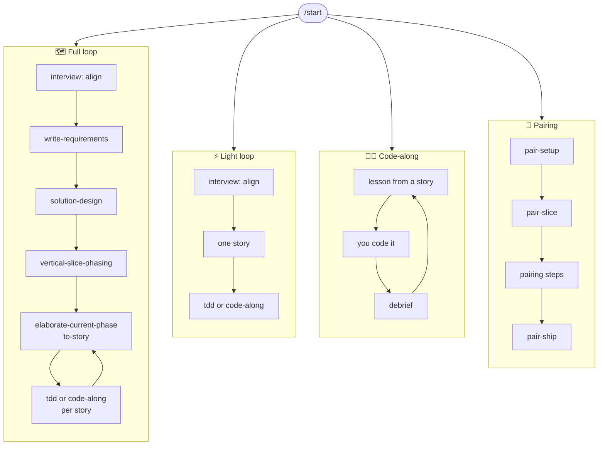

<h1 align="center">Skills</h1>

<p align="center">
  <b>Agent skills for building software the way people actually build it.</b><br/>
  Plan a feature, build it yourself, ship a small change, or pair with the agent,<br/>
  with stories a person can see and pictures that live in the docs.
</p>

<p align="center">
  
  
  
</p>

<p align="center">
  <a href="#-install">Install</a> ·
  <a href="#-quick-start">Quick start</a> ·
  <a href="#-the-four-modes">The four modes</a> ·
  <a href="#-stories-people-can-see">Stories</a> ·
  <a href="#-pictures-in-the-docs">Pictures</a> ·
  <a href="#-skill-reference">Reference</a>
</p>

---

## ✨ What this is

A set of skills (folders with a `SKILL.md` that your coding agent loads on
demand) organised as **one small kernel and four ways of working**:



Every mode reads and writes the same files in your repo, so you can switch
modes per story without losing anything.

**What's new in 2.0:** no dependency on any other skill repo, stories written
for people (with agent tasks inside them), and Mermaid diagrams everywhere,
validated before you see them, with a local viewer. See the
[changelog](CHANGELOG.md).

---

## 📦 Install

**Prerequisites:** an agent that loads `SKILL.md` skills (Claude Code, Codex,
Cursor, and others). Python 3 for the diagram tools. Node.js (for `npx`) if you
want diagrams validated; everything else works without it.

**Option A: the skills CLI** (copies the skills into your agent's skills folder)

```bash
npx skills@latest add robjsliwa/skills
```

**Option B: clone and link** (edit the skills in place, pull to update)

```bash
git clone https://github.com/robjsliwa/skills.git
bash skills/scripts/link-skills.sh      # symlinks every skill into ~/.claude/skills/
```

Restart your agent (or start a new session) so it picks the skills up.

> **Upgrading from 1.x?** 2.0 no longer needs `mattpocock/skills`. If you
> installed it only for these skills, remove it: its `tdd` has the same name
> as ours and would shadow it. Then run `/repo-setup` once per repo; it moves
> `docs/agents/issue-tracker.md` into the new profile and offers to split an
> old glossary-style `CONTEXT.md` into `GLOSSARY.md` plus a real system-context
> page.

---

## 🚀 Quick start

In the repo you are working on:

```
/repo-setup      # once per repo: tracker, test commands, docs layout, diagrams
/start           # tells you which mode fits what you want to do, and the first command
```

That's it. `/start` reads what is already in the repo (a plan in progress, an
open lesson, an active pairing slice) and points you at the next step. You can
also skip it and call any mode directly.

---

## 🧭 The four modes

| | Mode | Pick it when | Start with |
|---|---|---|---|
| 🗺️ | **Full loop** | The architecture is the hard part. A wrong call now means a rewrite later. | `/interview` then `/write-requirements` |
| ⚡ | **Light loop** | One coherent change, no real design choice. You could open the editor now. | `/light <the change>` |
| 🧑‍💻 | **Code-along** | A story exists and you want to write the code yourself and understand every line. | `/code-along <story>` |
| 🤝 | **Pairing** | The spec is clear enough to start; you want to build one small piece at a time, together. | `/pair-setup`, then `/pair-slice` |

Judge by weight, not size: a two-line change that decides the tenancy model is
full loop; a big mechanical change is light.

### 🗺️ Full loop

One feature, from idea to shipped code, one artifact per step. Each artifact is
a file under `docs/planning/<feature>/`, so you can `/clear` after any step and
the next skill picks up from disk.

| Step | Run | You get |
|---|---|---|
| 1. Align | `/interview` | shared understanding; `GLOSSARY.md`, `CONTEXT.md`, ADRs as you go |
| 2. Requirements | `/write-requirements` | `requirements.md`: the what and why, with a context diagram and the user journey |
| 3. Design | `/solution-design` | `design.md`: the how, with C4 container and behaviour diagrams; `CLAUDE.md`; ADRs |
| 4. Phase | `/vertical-slice-phasing` | `phases.md`: build order, walking skeleton first, with a story map |
| 5. Stories | `/elaborate-current-phase` | stories for this phase only, each one a change a person can see |
| 6. Build | `/tdd` or `/code-along` | the code, one story per session; then `/review-change` |
| 7. Next phase | `/elaborate-current-phase` | the next phase's stories, re-derived from the real code |

```text
/interview align on invoice reminders
/write-requirements                 → docs/planning/invoice-reminders/requirements.md
/clear
/solution-design docs/planning/invoice-reminders/requirements.md
/clear                              → design.md, CLAUDE.md, docs/adr/0004-*.md
/vertical-slice-phasing docs/planning/invoice-reminders/design.md
/clear                              → phases.md
/elaborate-current-phase docs/planning/invoice-reminders/phases.md
/clear                              → stories/01-01-owner-sees-overdue-invoices.md, ...
/tdd docs/planning/invoice-reminders/stories/01-01-owner-sees-overdue-invoices.md
/clear                              # one story per session; repeat until the phase is done
/elaborate-current-phase ...        # then the next phase, against the code you now have
```

Lost? `/planning-loop` reads `docs/planning/` and names the next step.

### ⚡ Light loop

A short align interview, one story (its tasks carry the small design), then
build. No requirements, design, or phases documents. If the change turns out
heavier than it looked, it tells you and hands over to the full loop.

```text
/light let owners resend an invoice email
# a few questions, a picture to correct, then one story to approve
/tdd docs/planning/resend-invoice/stories/01-01-owner-resends-an-invoice.md
```

### 🧑‍💻 Code-along

For any story from either loop, when you want to write it yourself. Each story
becomes a **lesson**: who it is for and the demo you will perform, a picture of
where it sits in the code you already have, only the ideas that are new to you,
then RED to GREEN steps you type into your own editor. Every code block in a
lesson comes from a reference solution that was actually built and run. When
you finish, a **debrief** looks at what you built, asks about anything you did
differently, and records what you now know. Only then is the next lesson written,
against the code you actually wrote.

```text
/code-along docs/planning/invoice-reminders/stories/01-01-owner-sees-overdue-invoices.md
# build it in your editor, at your pace; change what you think should change
/clear
/code-along           # debriefs 01-01; you commit; it writes the next lesson
```

`tdd` and `code-along` mix freely, story by story: delegate the wiring, build the
core yourself.

### 🤝 Pairing

The planning loop decides a whole feature up front. Pairing decides one small
piece at a time, with you at the keyboard as much as the agent. Every piece goes
through a branch and a PR whose body is the journal of how and why it was built.
State lives in `docs/pairing/`, so `/clear` costs nothing.

| When | Run | Does |
|---|---|---|
| Once per repo | `/pair-setup` | extends `/repo-setup` with stack, style, git flow, PR policy, pairing habits |
| New piece | `/pair-slice <spec> <piece>` | carves a slice with a scenario, demo, and picture; cuts the branch |
| Every session | `/pair` | reads the memory bank, briefs you, carries on |
| While building | (the `pairing` skill) | one step at a time: driver, navigator, ping-pong, or dictation |
| Before stopping | `/pair-checkpoint` | journal caught up, state saved, committed and pushed |
| Piece done | `/pair-ship` | PR with the journal, three-axis review, merge on your yes |

```text
/pair-setup docs/spec.md
/pair-slice docs/spec.md the walking skeleton
# "you drive" / "I'll write this one" / "write exactly: ..." / "ping-pong"
/pair-checkpoint
/clear
/pair                  # next morning: a short brief, then the next step
/pair-ship
```

---

## 👀 Stories people can see

AI-written stories tend to read like work orders: "Create the database,"
"Tenant port," "Wire the adapter." Each is real work, and none is something a
person can see. In 2.0 a **story** is one change a person can see, and the
work orders become **tasks** inside it.

| | Story (for people) | Task (for the agent) |
|---|---|---|
| Sized by | a change someone can see or use | one context window, one red-green run |
| Says | Scenario, Demo, Picture, Acceptance | interfaces, data, algorithm, sample code, TDD plan, Verify |
| Title | "Visitor follows a short link" | "Resolve route for `GET /{slug}`" |

Every story starts like this:

```markdown
# 02-04: Visitor follows a short link

## Scenario
Maya posted her bakery's short link on three sites. Her customers tap it on
their phones and expect to land on today's menu, not an error page.

## Demo
After this ships, I create a link to https://example.com/menu, open
http://localhost:8080/menu-1 in a browser, and land on the menu page.

## Picture
(one Mermaid diagram of the change a person notices)

## Acceptance
- [ ] Opening a short link lands on its target page. (R4)

## Tasks
- [ ] T1: Resolve route for GET /{slug}
- [ ] T2: Not-found page for unknown slugs
```

Before you ever see a breakdown, a **critic** reads it in a fresh context, as a
stakeholder would, and rejects stories whose titles name implementation, whose
demo is only a test run, or that exist only to set up another story. Big stories
are split by workflow step, business rule, happy then unhappy path, or one data
variation first, never by layer. The full format, the splitting patterns, and
the critic's rules live in the [`story`](skills/kernel/story) skill.

---

## 🖼️ Pictures in the docs

A picture is worth a thousand words, so the skills draw one whenever it makes a
question clearer, and they draw it in **Mermaid, inside the markdown file it
explains**. GitHub renders it, PR diffs show it change, and it sits right next
to the requirements, design, story, or ADR it belongs to.

- **C4 thinking, flowchart drawing.** Context (level 1) in `CONTEXT.md` and the
  requirements, containers (level 2) in the design, components (level 3) only
  when needed. They are drawn as flowcharts with a shared style, because
  Mermaid's own C4 types are still experimental and can't be laid out.
- **The right diagram for the question.** Journeys for what a person goes
  through, screen flows for which screen comes next, sequences for how a request
  flows, state diagrams for lifecycles, ER diagrams for data.
- **Show, then ask.** During interviews the agent draws what it thinks you mean
  and asks what is wrong with the picture. Correcting a drawing beats answering
  five questions.
- **Wireframes as sidecars.** A low-fidelity HTML mockup next to the markdown,
  linked from a Mermaid screen flow that stays the canonical record.
- **Checked before you see them.** Every diagram is validated with mermaid-cli,
  and the agent renders and looks at it before showing it to you.

### The docs viewer

A small local web page that renders your `docs/` with every diagram drawn, live
reloads as the agent writes, shows design options as cards you can pick, opens
mockups beside the text, and lets you click a box in a diagram to comment on it.
Your clicks go back to the agent through `.viewer/events.jsonl`.

```bash
python3 ~/.claude/skills/visualize/scripts/docs_viewer.py --open
```

(Use the path where your skills are installed. Or ask the agent to "open the
viewer.") It needs only Python 3 and binds to `127.0.0.1`.

---

## 📁 Where things go

```text
CONTEXT.md                 who uses the system, what's outside it, why it exists (C4 level 1)
GLOSSARY.md                the project's language; every skill uses these words
CLAUDE.md                  the agent contract (stack, layering, definition of done)
docs/
  agents/profile.md        tracker, docs locations, test and run commands, diagram settings
  adr/NNNN-*.md            decisions that are hard to reverse
  planning/<feature>/
    requirements.md        write-requirements
    design.md              solution-design
    phases.md              vertical-slice-phasing
    stories/NN-MM-*.md     to-story or light (or issues in your tracker)
    mockups/*.html         wireframe sidecars
    lessons/NN-MM-*.md     code-along, with debriefs
  pairing/                 the pairing memory bank
  code-along/              your learner notes and learning records
.viewer/events.jsonl       viewer clicks (gitignored, safe to delete)
```

If `docs/agents/profile.md` names a real tracker (GitHub, GitLab, Jira, Linear),
requirements and stories are filed there instead of as files. Design and phases
are always files.

---

## 📚 Skill reference

<details open>
<summary><b>Modes</b>: where you start</summary>

| Skill | What it does |
|---|---|
| `start` | Reads the repo and your goal, recommends a mode and its first command. |
| `light` | Align briefly, write one story with its own small design, build it. Escalates when the change is heavy. |
| `planning-loop` | The full loop's router: reads `docs/planning/` and names the next step. |
| `code-along` | Turns a story into a verified lesson you code yourself, then debriefs you. |
| `pair` and friends | The pairing loop: `pair-setup`, `pair-slice`, `pair`, `pairing`, `pair-checkpoint`, `pair-ship`. |

</details>

<details open>
<summary><b>Kernel</b>: the shared disciplines every mode uses</summary>

| Skill | What it does |
|---|---|
| `repo-setup` | Writes `docs/agents/profile.md`; migrates 1.x repos. |
| `interview` | One question per turn, a recommendation every turn. **Align** on intent and language, or **decide** a tree of coupled decisions. Draws a picture and asks what's wrong with it. |
| `glossary` | Owns `GLOSSARY.md`, `CONTEXT.md`, and the ADR format; challenges fuzzy terms the moment they appear. |
| `visualize` | Mermaid notation guide, C4 style, mockup sidecars, the validator, and the docs viewer. |
| `story` | The story format, splitting patterns, and the critic. |
| `tdd` | Builds a story task by task, red-green-refactor, then performs the demo. |
| `diagnose` | A gated loop for hard bugs: red signal first, then hypotheses, then the fix. |
| `review-change` | Three parallel reviews of a change: standards, spec (the story or slice), and decisions (ADRs, glossary). |

</details>

<details>
<summary><b>Full loop</b>: planning skills</summary>

| Skill | What it does |
|---|---|
| `write-requirements` | Template-driven requirements: goals, non-goals, actors (with a context diagram), the user journey, numbered requirements, non-functional rows, failure modes, acceptance criteria. Refuses to write from a cold start. |
| `solution-design` | The design document: ports before adapters, the deterministic and probabilistic split, data, seams, trust boundaries, testing strategy, C4 and behaviour diagrams, ADRs, and the `CLAUDE.md` contract. |
| `vertical-slice-phasing` | Interviews you on build order alone and writes `phases.md` with a story map, a walking skeleton first, a definition-of-done script, and a traceability table. |
| `elaborate-current-phase` | Details only the current phase into stories, and re-derives the next one from the built code. |
| `to-story` | Finds the changes a person would see, gives each story its tasks with the design carried in, runs the critic, and publishes. |

</details>

<details>
<summary><b>Learning</b>: <code>teach-me</code>, <code>let-me-code</code></summary>

**`teach-me`** teaches a topic over many sessions in a teaching workspace. Every
lesson is a chapter: motive before mechanism, a hand-drawn figure of the whole
machine and one per state change, algorithms traced by hand before code, try-its,
a quiz, challenges, and a design note. A build script cuts code from a verified
module, recomputes every value the prose quotes, and the page is rendered and
looked at before it reaches you. Needs Python 3 and Google Chrome.

```text
/teach-me consistency proofs
```

**`let-me-code`** writes a TDD tutorial that guides you to type each line
yourself. Trigger with "teach me to build X" or "don't write the code for me."

</details>

<details>
<summary><b>Gamedev</b>: branching stories for games</summary>

Four skills that turn a game-story idea into an authored, branching story you
build one piece at a time, with story content in git next to the code.

```text
narrative-grill ──► story-bible.md ──► story-decompose ──► beats/*.md
                        ▲                                      │
                        └──────────── beat-grill ◄─────────────┘ (one beat at a time)
                  subquest-fill ──► beats/subquests/<faction>/*.md
```

| Skill | What it does |
|---|---|
| `narrative-grill` | Interviews you into `story-bible.md`: premise, theme, world rules, factions, arc, tone, a structural spine, and the world-state flags. |
| `story-decompose` | Breaks the spine into a `beats/` folder of stubs, in order. Refuses to invent plot. |
| `beat-grill` | Expands one beat into branching content: choices, flags, consequences, dialog. |
| `subquest-fill` | Seeds side quests hanging off existing factions and flags. |

</details>

<details>
<summary><b>Scaffolding</b>: <code>go-boilerplate</code></summary>

Scaffolds a Go REST API service with Chi, OpenTelemetry, and Swagger: module and
router, tracing and metrics, code-first OpenAPI, Makefile, Dockerfile,
docker-compose, and a GitHub Actions workflow.

| Parameter | Required | Default | Description |
|---|---|---|---|
| `project_name` | Yes | | Kebab-case name, e.g. `my-service` |
| `github_user` | Yes | | GitHub user or org that owns the repo |
| `description` | Yes | | One-sentence description |
| `dest_dir` | No | `.` | Where to install the files |
| `module_path` | No | `github.com/{github_user}/{project_name}` | Go module path override |

```text
Run go-boilerplate with project_name=widget-svc, github_user=acme,
description="Service for managing inventory widgets."
```

See [`INSTALL.md`](skills/engineering/go-boilerplate/INSTALL.md) for headless use.

</details>

---

## 🛠️ Working on this repo

```bash
python3 scripts/check-skills.py                               # frontmatter, unique names, no outside dependencies
python3 skills/kernel/visualize/scripts/mermaid_check.py .    # every Mermaid block parses
bash scripts/list-skills.sh                                   # list skill folders
```

Skills refer to each other by name ("the `story` skill's `FORMAT.md`"), never by
path, so they work however your agent installs them. The plan for 2.0, written
with these skills, is in [`docs/planning/skills-v2/`](docs/planning/skills-v2/),
with its decisions in [`docs/adr/`](docs/adr/).

```text
skills/
  kernel/        repo-setup, interview, glossary, visualize, story, tdd, diagnose, review-change
  modes/         start, light
  engineering/   planning-loop, write-requirements, solution-design, vertical-slice-phasing,
                 elaborate-current-phase, to-story, code-along, let-me-code, go-boilerplate
  pairing/       pair, pair-setup, pair-slice, pairing, pair-checkpoint, pair-ship
  learning/      teach-me
  gamedev/       narrative-grill, story-decompose, beat-grill, subquest-fill
  deprecated/    design-interview, init-go-project, phased-implementation-plan (not linked)
```

## 🙏 Credits

Version 1 was built on top of [Matt Pocock's skills](https://github.com/mattpocock/skills),
and the grilling interview, the glossary-as-shared-language idea, and tracer-bullet
slicing all started there. The visual brainstorming idea was inspired by
[Superpowers](https://github.com/obra/superpowers). Story splitting follows the
Humanizing Work guide to splitting user stories, and the diagrams borrow Simon
Brown's [C4 model](https://c4model.com).

## License

MIT
