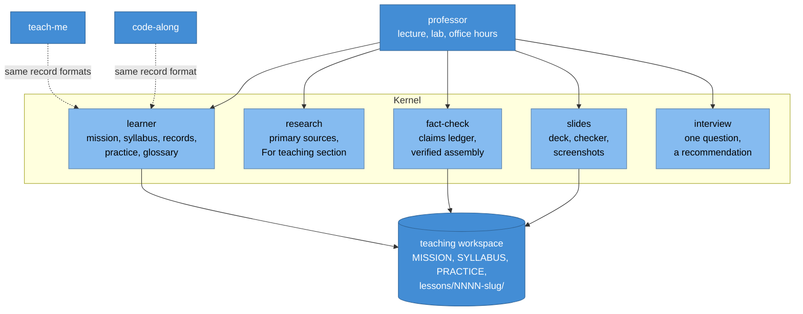
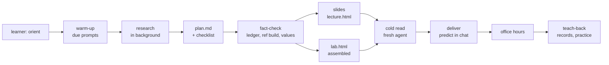

# Professor: Design

**Status:** agreed
**Date:** 2026-10-28
**ADR:** [0005](../../adr/0005-learning-kernel-and-no-quiz.md)

`professor` teaches any subject the way a well-run course does: a short
lecture that builds one mental model, a lab that puts it to work in a real
project, and a professor available for questions, one lesson per sitting
across many sessions. It keeps what `teach-me` got right (a stateful
workspace, the learner's record, primary sources, and "nothing is asserted")
and fixes what made its lessons hard to follow.

## Why teach-me's lessons were hard to follow

Read against Lesson 2 of a real `teach-me` course ("One Phone, Many Views",
a SwiftUI dial pad on top of a Swift package):

| What happened | Where | What the evidence says |
|---|---|---|
| Theory before code: a key-by-key trace of `Phone`, `parsed` and `hint`, and an observation loop over three views, all before the reader had created the project or seen the class. | §2.3–2.4; the code arrives in §2.5 | Concrete, then picture, then abstract (Fyfe et al. 2014). Tracing unseen code is extraneous load (Sweller et al. 2019). |
| Edge cases inside the core explanation: Default Actor Isolation and SE-0466, package deployment targets, NANPA area codes, and an observation quirk about the call log, all on the way to explaining `@Observable`. | §2.2, §2.3, §2.4 | One new idea at a time, small steps (Rosenshine 2012); coherence: leave out what is not essential now (Mayer 2020). |
| Clipped, literary prose: "The motive, as two losses." "The left panel is the classic one." "Map it back to Algorithm 1. `parsed` is step 2." | §2.1, §2.5.2 | Conversational style helps (Mayer's personalisation principle); decoding sentences is load the learner did not need. |
| One page doing four jobs: lecture, reference manual, lab, quiz. Setup clicks in §2.5.1 after concurrency settings were explained without context in §2.2. | whole page | Segment into learner-paced pieces; put procedural information where it is used (van Merriënboer et al. 2002). |
| A multiple-choice quiz at the end. | Check yourself | With feedback, short answer beats multiple choice (Kang et al. 2007); constructive beats active (Chi & Wylie 2014). |

The rewrite that prompted this design reordered the same material: problem →
set up the project → build the model → trace it → build the views → tests and
the quirks they reveal → run on the phone → what comes next → challenges. It
kept every fact. That ordering is now the lab's shape (LAB.md), and the
explanation it opens with is the lecture's.

## What teach-me got right, and keeps

- The **workspace** carries state between sessions: mission, records, glossary,
  resources. Now owned by the `learner` kernel skill, same formats.
- **Zone of proximal development** read from learning records, and the
  `detour` round trip that uses it.
- **Nothing is asserted**: code is cut from a verified module, every number is
  recomputed, the page is rendered and looked at. Now the `fact-check` kernel
  skill, generalised beyond Go and hashes to any subject, and the deck checker
  in `slides`.
- **Primary sources** before teaching.

## The research

The full mapping from finding to rule is
[PEDAGOGY.md](../../../skills/learning/professor/PEDAGOGY.md). In short:

1. Organise around a real task (Merrill 2002; van Merriënboer et al. 2002):
   every course has a project; every lesson is a milestone.
2. Activate prior knowledge, review daily (Merrill; Rosenshine 2012): warm-up
   prompts, a "last time" slide, anchors from the learner's own domains.
3. Working memory is small (Sweller et al. 2019; Mayer 2020): one idea per
   lesson and per slide; edge cases go to a parking lot with a destination.
4. Worked examples, then fading; expertise reversal (Kalyuga et al. 2003):
   one worked example per lecture; guidance fades as records grow.
5. Concreteness fading (Fyfe et al. 2014): case → picture → name.
6. Multimedia principles (Mayer 2020): a deck, built in steps, words beside
   pictures, learner-paced, conversational.
7. Generative engagement (Chi & Wylie 2014; Bisra et al. 2018, g = 0.55 for
   self-explanation): predictions, checkpoints, challenges, teach-back.
8. Attempt before instruction (Sinha & Kapur 2021; Kornell et al. 2009), with
   the caveat that prequestions alone did not help in a live classroom
   (Geller et al. 2017): predict slides with immediate answers.
9. Retrieval and spacing (Dunlosky et al. 2013; Cepeda et al. 2006): the
   practice queue.
10. Feedback and format (Kang et al. 2007): open answers in chat, no quiz.
11. Check for understanding, aim for ~80% success (Rosenshine 2012).
12. Integration (Merrill 2002): challenges in the learner's own context.

## Architecture

`professor` holds only the teaching method: the session state machine, the
pedagogy, the voice, the lesson plan, the lecture arc, the lab shape, office
hours, and the cold read. The kernel skills hold formats and tools, and are
usable without it.

## A lesson

A lesson spans two or three sittings; `SYLLABUS.md`'s status column
(`planned → researched → lectured → lab → done`) says where to resume.

## Decisions

1. **Two pages per lesson, not one.** A lecture deck and a lab page do
   different jobs (a mental model versus a procedure) and are read
   differently (stepped through once versus worked down beside an editor).
2. **The deck is HTML with a transcript, not a slide file.** It opens from
   disk, needs no presenter, keeps words beside pictures, and can be checked
   automatically. The handout view prints.
3. **No skill per subject.** Five lenses answer the four things that differ
   between subjects (primary sources, project, lab step, verification). A
   workspace's `NOTES.md` holds subject-specific conventions.
4. **The professor never writes the learner's project** unless `NOTES.md`
   says so. The reference solution lives in `build/ref/`.
5. **No multiple-choice quiz.** ADR 0005.
6. **teach-me stays** until its workspaces have moved; `professor` adopts them
   in place.

## Later

- Retire `teach-me` once no workspace depends on its chapter format.
- An optional narrated mode for the deck (the modality principle favours
  narration over on-screen text), if a text-to-speech path becomes available
  in the agents that load these skills.
