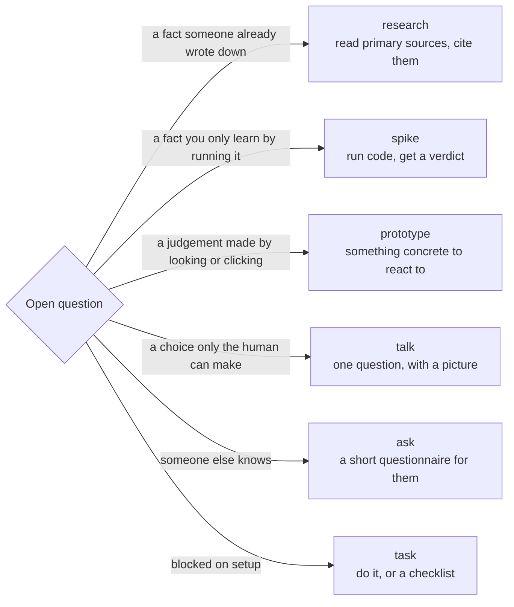
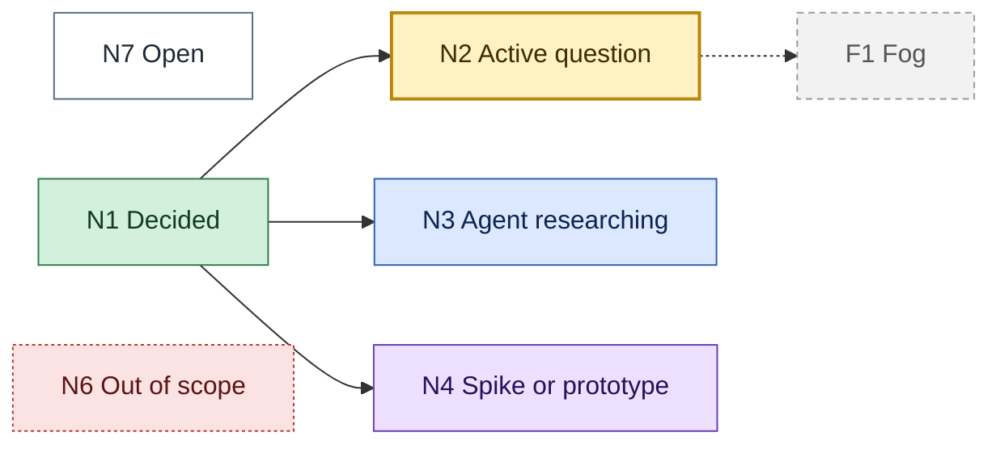
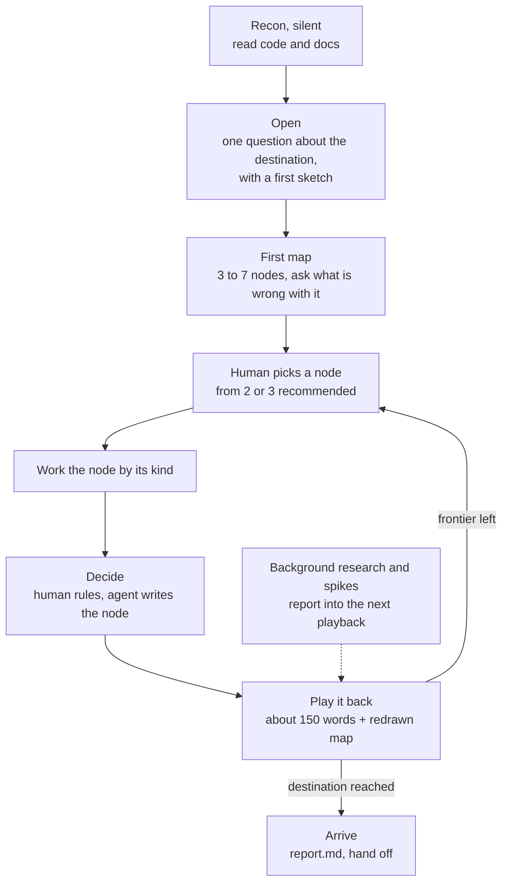

# Research skills: Design

**Status:** agreed
**Date:** 2026-10-14
**Builds on:** [skills-v2 design](../skills-v2/design.md), ADR 0003 (Mermaid is canonical)
**ADRs:** [0004](../../adr/0004-research-lives-in-files.md)

Four skills for the time before anyone knows what to build: `trailblazer` (a
research mode you do together), and three kernel skills it and every other mode
can call, `research`, `spike`, and `prototype`.

The through-line: **research is a conversation with a picture in the middle.**
One question at a time, the agent fetches the facts before asking, every fork is
shown as diagrams, the map is redrawn after every decision, and the human picks
where to go next.

## What went wrong with the ticket-map approach

| Symptom | Cause | Fix here |
|---|---|---|
| Six orthogonal questions before seeing anything | The whole frontier is asked in one round, breadth-first, before any research | One question per turn, and a picture of the current understanding comes first |
| Brainstorming turns into backlog admin | Unknowns become tracker tickets the moment they are named | Nodes are files in the repo; a tracker issue is optional and only mirrors the map |
| Hard to follow which decision is where | The map is a list of ticket links | The map is a Mermaid tree with node states coloured, redrawn after every decision |
| Questions that are hard to decide | Forks posed in prose | Every fork with two or more structural options is shown as small side-by-side diagrams |
| The agent picks the next ticket | "Take the first frontier ticket" | The agent recommends two or three nodes and the human picks |

Kept from it, because they work: the map as an index (a decision lives in one
place), the fog of war (do not chart what you cannot see yet), destination and
out of scope as the scope fence, AFK research by subagents, and "finding facts
is the agent's job, decisions are the human's."

## Six ways to settle a question

Every node on the map has a **kind**, and the kind picks the tool.



Read the arrows as the test: who or what holds the answer decides how you get it.

`research`, `spike`, and `prototype` are kernel skills, so `light`, `pairing`,
`tdd`, and `interview` call them too. `talk` is an `interview` turn. `ask` and
`task` live inside `trailblazer`.

### Spike, research, prototype: the boundary

| | research | spike | prototype |
|---|---|---|---|
| Answers | What is documented to be true? | Does it actually work, here, at our scale? | What should it look like or how should it behave? |
| Method | Read docs, specs, source | Run throwaway code against the real thing | Build something the human clicks and reacts to |
| Human needed | No (AFK) | Usually not (AFK), to frame and accept | Yes, to react |
| Output | Findings note with citations | Spike brief with a verdict | Self-contained HTML (or in-app variants) plus the decision, redrawn as Mermaid |
| Code fate | None | Unmerged `spike/<slug>` branch | Kept as a record; winner rewritten properly |

A spike is not a small trailblazer. Trailblazer navigates many coupled questions
over sessions; a spike answers one technical question in one sitting. Trailblazer
calls spikes, and so does everyday programming.

## Trailblazer

User-invoked mode: `/trailblazer <idea or topic>` to start, `/trailblazer <topic>`
(or no argument) to resume.

### Files

```text
docs/research/<topic>/
  map.md                  the trail map: index, picture, frontier, decisions
  nodes/N<k>-<slug>.md    one per node: question, evidence, options, decision
  findings/<slug>.md      research notes (written by research)
  spikes/<slug>.md        spike briefs (written by spike)
  prototypes/<slug>.html  prototypes (written by prototype)
  report.md               written on arrival
```

Settled terms go to the repo's `GLOSSARY.md`; decisions that clear the bar become
ADRs in `docs/adr/`; the map links to both.

### The map

`map.md` sections: Status, Destination, Anti-goals, The map (Mermaid), Frontier,
Decisions so far, Assumptions, Fog, Out of scope, Terms in play, Session log.

Node states, as Mermaid classes:



White is open, green is settled, yellow is the conversation now, blue is an agent reading, purple
is something being built to find out, grey dashed is fog, red dashed is ruled out.
Edges mean "depends on." Past about fifteen nodes, a decided subtree collapses
into one green node ("Storage, 3 decisions") that links to its node files.

### The cadence



The loop runs one node at a time. Background subagents work research and spike
nodes while the conversation is on another node, and their results arrive in the
next playback. Only user decisions trigger a playback; a background result that
changes the question on the table gets one line after the current turn. Two turns
from the user's first message to the first real node is the target: the opening
message drafts the destination and anti-goal for correction instead of asking for
them. The docs viewer starts with the first map, so the picture is rendered, not
Mermaid source in a terminal.

Recommending the next node: highest **risk if wrong** times **uncertainty**,
then most **unblocked downstream**. The riskiest assumption gets probed first.

### Evidence strength

Every fact in a node carries how we know it: **ran it** (spike or prototype
output), **cited** (primary source, linked), **inferred** (reasoned from cited
facts), or **assumed** (nobody checked). Assumptions are listed on the map with
the risk if wrong and the node that would check them.

### Arrival and hand-off

The trail ends when the frontier toward the destination is empty and no fog is
left in scope. `report.md`: destination, the route as decisions, the evidence,
open risks and assumptions, and the recommended next step:

| Destination | Next |
|---|---|
| A decision | the ADR; done |
| A spec (a feature, architecture-heavy) | `write-requirements` (reads the report as its interview) |
| A change (small, or one piece) | `light`, or `pair-slice` with the report as source |
| A recommendation | the report; an ADR if it commits to something |
| An understanding | the report; `teach-me` to go deeper |

A trail can also be **parked**: a partial report says what is decided, open,
and running, and how to resume.

## Spike

`/spike <question>`, or called by trailblazer, light, pairing, tdd, a spike story.

1. **Frame.** Question, hypothesis, pass and fail criteria, timebox. Two to four lines.
2. **Check.** For an outside dependency: release recency, docs, license, install friction.
3. **Isolate.** `git worktree add ../<repo>-spike-<slug> -b spike/<slug>`; or a scratch dir outside the repo when there is no git. Never the main working tree.
4. **Build** the smallest runnable thing. No tests, no abstractions, hardcode the rest.
5. **Stress** one edge case or failure mode that the question cares about.
6. **Measure** with real output.
7. **Verdict:** Confirmed, Rejected, or Partial. A rejected spike that rules a path out is a success.
8. **Brief** (question, verdict, evidence, sharp edges, recommended path, what the real build should copy and what it must not), then clean up: remove the worktree, keep the branch unmerged.

Briefs go to `docs/research/<topic>/spikes/<slug>.md` inside a trail, otherwise
`docs/spikes/NNNN-<slug>.md`.

## Prototype

Three branches, each a template under `assets/`:

- **LOGIC**: a pure module (reducer, state machine, functions) behind a single HTML page with free-play buttons and guided scenarios.
- **UI**: radically different variants. In an app, on the real route behind `?variant=` with a floating switcher; with no app yet, a single HTML file with the same switcher.
- **FLOW**: a click-through simulator of a sequence across participants, with failure injection (timeout, invalid token, duplicate delivery), payload and per-participant state panels.

Every prototype carries a **tradeoff drawer** (what each variant gains and gives
up) and a **feedback bar**: opened through the docs viewer it sends picks and notes
to `.viewer/events.jsonl`; opened as a file it copies them to the clipboard.

Closing the loop: the decision a prototype settles is written back as Mermaid (a
state diagram from LOGIC, a sequence from FLOW, a screen flow from UI) into the node
or design doc. The HTML stays as the record; it is never the spec.

Trigger mid-conversation: "stop asking, show me" is enough.

## Research

A background subagent with a brief: the question, why it matters, what is already
known, where to look first, and the output path. Primary sources only, each claim
cited with its strength, conflicts between sources flagged, the date checked, and
a closing "what this means for us" tied to the question. A **recon** variant reads
the local code and docs and reports what exists, for trailblazer's first step and
interview's "explore before asking."

## Changes elsewhere

- `start`: a fifth row for foggy or huge ideas; resumes a trail in progress.
- `interview`: facts go to `research`, can-it-work to `spike`, show-me to `prototype`.
- `light`: a third escalation, fog, goes to `trailblazer`.
- `story`: spike stories run with `spike`.
- `pairing`: a step that cannot be planned without knowing gets a spike; the brief lands in the journal.
- `write-requirements`: accepts a trail report in place of an interview.
- `repo-setup`: the profile gains `Research` and `Spikes` locations.
- viewer: a `/prototype` route that runs scripts for files under a `prototypes/` folder, and a `prototype` event type.
