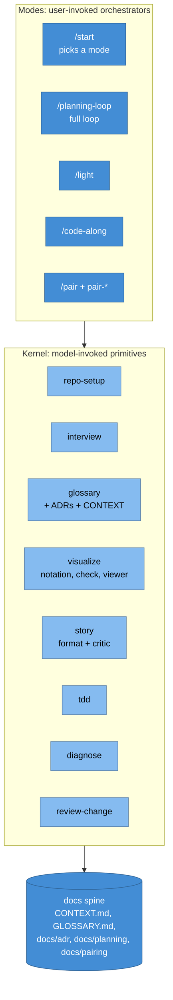
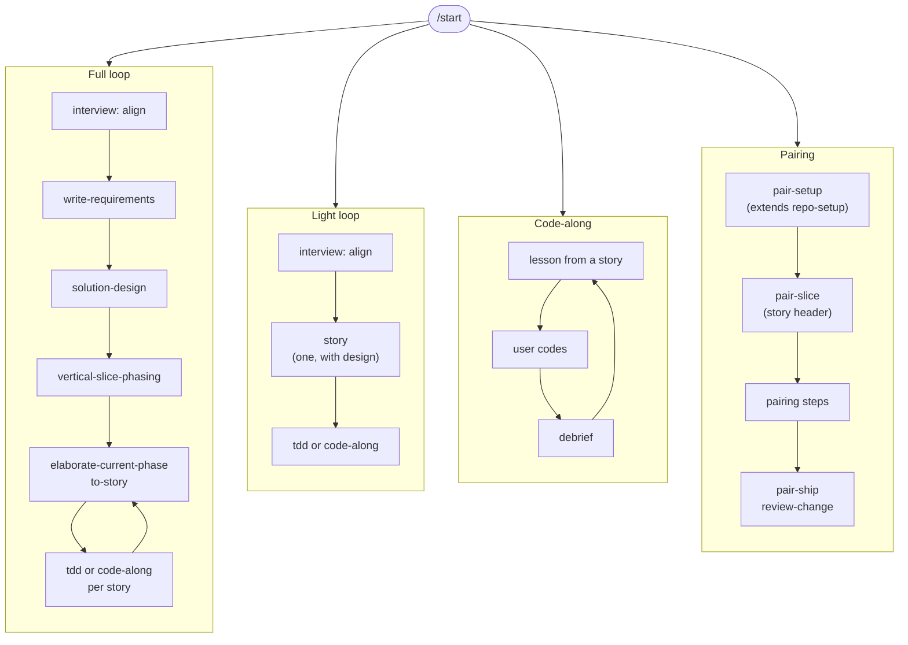

# Skills v2: Design

**Status:** agreed
**Date:** 2026-10-13
**Requirements:** [requirements.md](requirements.md)

The through-line: a small **kernel** of reusable, model-invoked skills holds every discipline; four thin **modes** route through it; everything they produce lands on one **docs spine** in the user's repo. Stories are written for people and carry tasks for agents. Pictures are Mermaid, inside the files they explain.

## Decisions at a glance

1. Kernel plus modes. Modes call kernel skills; modes never call each other (R11).
2. One profile, `docs/agents/profile.md`, written by `repo-setup`, read by everything (R2).
3. `CONTEXT.md` is system context (C4 level 1); `GLOSSARY.md` is language (R4). See ADR 0002.
4. A story owns its tasks, in the same file. See ADR 0001.
5. Diagrams are Mermaid in the artifact. C4 concepts, drawn as flowcharts with shared class definitions. Wireframes are HTML sidecars linked from a Mermaid screen flow. See ADR 0003.
6. The viewer is a stdlib Python script inside `visualize`.
7. Skill names avoid collisions with Claude Code built-ins (`/review`, `/init`) and are short.

## Architecture overview



Each box is a skill folder. The kernel is where rules live once; a mode is a short route over it plus its own state files.

## Skill inventory

| Folder | Skill | Kind | Replaces (v1) |
|---|---|---|---|
| `skills/kernel/repo-setup` | `repo-setup` | user + model | `setup-matt-pocock-skills` |
| `skills/kernel/interview` | `interview` | user + model | `grill-with-docs`, `grilling`, `design-interview` |
| `skills/kernel/glossary` | `glossary` | model | `domain-modeling` |
| `skills/kernel/visualize` | `visualize` | user + model | new |
| `skills/kernel/story` | `story` | model | story rules formerly inside `to-story` |
| `skills/kernel/tdd` | `tdd` | user + model | `tdd` |
| `skills/kernel/diagnose` | `diagnose` | user + model | `diagnosing-bugs` |
| `skills/kernel/review-change` | `review-change` | user + model | `code-review`, `pair-ship/REVIEW.md` |
| `skills/modes/start` | `start` | user | new |
| `skills/modes/light` | `light` | user | the README's light path |
| `skills/engineering/*` | full loop and code-along, unchanged names | user | rewired |
| `skills/pairing/*` | pairing loop, unchanged names | user | rewired |

Skills link by folder name, so names are global. `tdd` overlaps with `mattpocock/skills`; the README says to remove that repo.

## The profile

`docs/agents/profile.md`, written by `repo-setup`, replaces `docs/agents/issue-tracker.md`:

```markdown
# Agent profile

## Tracker
Kind: local | github | gitlab | jira | linear | other
Notes: <how to create an issue, link blockers, label; or "files under docs/planning">
Labels: ready-for-agent, in-progress, done   # triage vocabulary

## Docs
Planning: docs/planning
ADRs: docs/adr
Pairing: docs/pairing
Code-along: docs/code-along

## Commands
Fast tests: <cmd>
Full check: <cmd>
Run the app: <cmd>      # used for story demos

## Diagrams
Validate: npx -y @mermaid-js/mermaid-cli   # or "off"
Viewer port: 4178
```

Every skill that needs one of these reads the profile. If it is missing, the skill uses the defaults shown and says once that `/repo-setup` would make it explicit.

## The docs spine

```
CONTEXT.md              glossary skill: C4 L1, actors, outside the boundary, why
GLOSSARY.md             glossary skill: terms, definitions, _Avoid_ words
CLAUDE.md               solution-design and pair-setup blocks (agent contract)
docs/agents/profile.md  repo-setup
docs/adr/NNNN-*.md      glossary skill's ADR format, written by any skill
docs/planning/<slug>/
  requirements.md       write-requirements
  design.md             solution-design
  phases.md             vertical-slice-phasing
  stories/NN-MM-*.md    story format (via to-story or light)
  mockups/*.html        visualize: wireframe sidecars
  lessons/              code-along
docs/pairing/           pairing memory bank
docs/code-along/        learner state
.viewer/events.jsonl    visualize viewer (gitignored, ephemeral)
```

## The story format

The unit a person reads. Owned by the `story` skill (`skills/kernel/story/FORMAT.md`). Used by `to-story`, `light`, `code-along`, `tdd`, and as the human header of a pairing slice.

```markdown
# NN-MM: <What a person can now do, in glossary words>

**Status:** ready | in-progress | in-lesson | done
**Phase:** <n, name> or none
**Blocked by:** <story ids> or none
**Serves:** R3, R7

## Scenario
Two sentences. A real person, what they are trying to get done, why it matters now.

## Demo
After this ships, I <open / run / click> ___, <do> ___, and see ___.

## Picture
<one Mermaid diagram: the slice of the journey, screen flow, or sequence this story lights up>

## Acceptance
- [ ] <observable outcome, in the user's words> (R3)

## Out of scope
<what this story leaves for later, and which story takes it>

## Tasks
- [ ] T1: <technical title>
- [ ] T2: ...

### T1: <technical title>
**Design:** interfaces and types, data, algorithm, sample code, files (only what this task needs)
**TDD plan:** numbered RED-first tests, `Subject_Condition_Outcome`, at named seams
**Verify:** commands and expected output

## Verification
<the demo as commands, plus the full test command>
```

Rules the critic checks (`skills/kernel/story/CRITIC.md`):

1. The title says what a person can do, using glossary terms, and names no implementation artifact (R14).
2. The Demo is something a person does and sees. A test run alone is not a demo (R12, R16).
3. The Scenario names a person and a reason, in plain words.
4. The Picture shows the user-visible slice, uses glossary terms as node labels, and has at most about 12 nodes.
5. Every acceptance line is observable from outside the code and tied to a requirement id.
6. One to five tasks. More than five means split the story with a splitting pattern (`SPLITTING.md`).
7. The breakdown as a whole: the first story is a walking skeleton, no story exists only to set up another, and the stories read in order as a narrative of the product getting better.

Contract-first survives as T1 of the walking skeleton story. Infrastructure, schema, and ports are tasks.

## Mode routes



Code-along is reached from the full loop or the light loop once a story exists; it is a build mode with its own state, not a planning route.

## Interview

`interview` merges v1's `design-interview` with alignment grilling. One question per turn, a recommendation every turn, the soft spot named, dependency order, explore before asking. Two subjects:

- **Align**: shared understanding of intent and language. Terms are challenged against `GLOSSARY.md` and settled ones are written as they happen (via `glossary`). Output: the conversation, plus glossary and ADR updates. The light and full loops start here.
- **Decide**: a tree of coupled decisions. Output: a findings document, or the caller's document.

New turn type, **show, then ask** (R20): draw the agent's current understanding as one Mermaid diagram (via `visualize`), then ask the single question "what is wrong with this picture?" with a recommendation of where the agent is least sure. Used when the subject is structural (actors, flow, states, boundaries) and at least once per align session.

## Visualize

Reference files in `skills/kernel/visualize/`:

- `NOTATION.md`: question to diagram to artifact table, the C4 levels, and the drawing rules (one idea per diagram, roughly 12 nodes, caption sentence, glossary terms as labels, stable node ids).
- `C4-STYLE.md`: the shared `classDef` block and node label convention (`Name<br/>[Kind]<br/>purpose`).
- `MOCKUPS.md`: the HTML sidecar contract for wireframes.
- `scripts/mermaid_check.py`: extract every Mermaid block from markdown files, validate with `mmdc`, optionally render PNGs to a scratch folder for the agent to look at.
- `scripts/docs_viewer.py`: the local viewer.

### Diagram choice

| Question | Diagram | Lives in |
|---|---|---|
| Who uses it, what is outside | C4 L1 context: flowchart, person and system classes | `CONTEXT.md`, requirements |
| What the user goes through | `journey` | requirements, phases (story map) |
| Which screens in which order | flowchart screen flow, nodes link to mockups | requirements, stories |
| What the deployables are | C4 L2 containers: flowchart with subgraphs | design |
| What is inside one container | C4 L3 components: flowchart | design (only when needed) |
| How a request flows | `sequenceDiagram` | design, story Picture, task |
| What states it can be in | `stateDiagram-v2` | design, task |
| What the data is | `erDiagram`; `classDiagram` for ports and domain types, sparingly | design, task |
| Which option and why | two or three small diagrams side by side in an options block | interview, ADR |
| What this change did | one before/after diagram | PR body |

### Viewer

`python3 skills/kernel/visualize/scripts/docs_viewer.py [--root .] [--port 4178] [--open]`

- Binds 127.0.0.1. Lists markdown under `docs/` plus root `CONTEXT.md`, `GLOSSARY.md`, `README.md`, `CLAUDE.md`.
- Renders markdown in the browser with marked and Mermaid from jsDelivr. Polls file mtimes and reloads on change.
- An options block (below) renders as cards with a Choose button.
- Links to `*.html` under `mockups/` open in a framed preview.
- Clicking a rendered Mermaid node opens a comment box.
- Choices and comments append JSON lines to `.viewer/events.jsonl`: `{"ts", "type": "choice"|"comment", "file", "block", "choice"|"node", "text"}`. The agent reads and then truncates the file each turn it uses the viewer.

Options block, plain markdown so it reads fine on GitHub:

```markdown
<!-- options: storage-shape -->
### Option A: one table per tenant
<mermaid block>
Tradeoff line.

### Option B: shared table with tenant_id
<mermaid block>
Tradeoff line.
<!-- /options -->
```

When the user picks, the chosen option's diagram moves into the artifact it decides (requirements, design, ADR), and the options block is removed.

## Review

`review-change` is v1's `pair-ship/REVIEW.md` lifted into the kernel: three axes (Standards, Spec, Decisions) in parallel sub-agents, against a fixed base. The spec source is a story file, a slice file, or a PR description. `pair-ship` and the full loop both call it.

## Testing strategy

These are prompts, so "tests" are checks run in CI-able scripts plus manual sessions:

- Frontmatter check: every `SKILL.md` has `name` equal to its folder and a `description`.
- Independence check: no `mattpocock`, `grill-with-docs`, `setup-matt-pocock-skills`, `domain-modeling`, `diagnosing-bugs`, or `design-interview` references outside attribution and changelog.
- Mermaid check: `mermaid_check.py` over the repo passes.
- Viewer check: start it, fetch `/`, a document, and post a choice event.

## Decisions that became ADRs

- [0001](../../adr/0001-story-owns-tasks.md): a story owns its tasks, in one file.
- [0002](../../adr/0002-context-and-glossary.md): `CONTEXT.md` is system context; `GLOSSARY.md` is language.
- [0003](../../adr/0003-mermaid-canonical-diagrams.md): Mermaid in the artifact is the canonical diagram; C4 as flowcharts; HTML mockup sidecars.

## Out of scope (deferred)

Next SDLC stages arrive as kernel skills with their own `docs/` folder (`docs/release`, `docs/ops`). Modes do not change for them.
