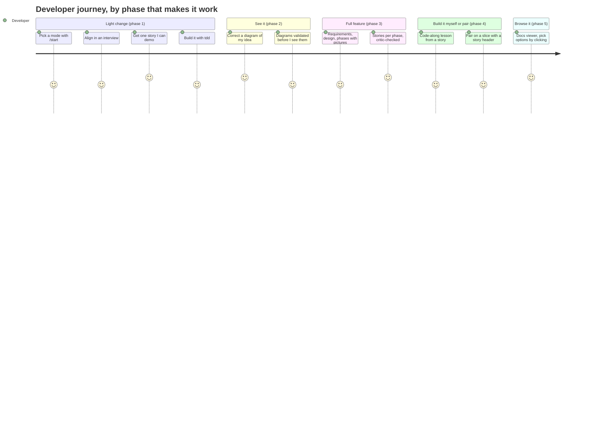

# Skills v2: Phased Implementation Design

**Status:** all phases built in one release (2.0.0)
**Date:** 2026-10-13
**Scope:** build order for [design.md](design.md). The architecture is fixed input.

The thesis to prove first: the kernel can carry a whole mode with no outside skills. The light loop is the smallest mode, so it goes first; every later phase moves another mode onto the same kernel.

## Story map



## Phase 1: Light loop on the kernel
**Status:** done
Delivers `/start`, `/light`, `repo-setup`, `interview`, `glossary`, `story` (format, splitting, critic), and `tdd`. Acceptance: a change goes from an idea to a demoable story to code with no outside skill.

## Phase 2: Visualize
**Status:** done
Delivers the notation guide, C4 style, mockup contract, `mermaid_check.py`, and show-then-ask in `interview`. Acceptance: every Mermaid block in the repo validates.

## Phase 3: Full loop on the kernel
**Status:** done
Rewires `write-requirements`, `solution-design`, `vertical-slice-phasing`, `elaborate-current-phase`, `to-story`, and `planning-loop`. Requirements carry actors and a journey; design carries C4 L2 and behaviour diagrams; phasing carries a story map.

## Phase 4: Code-along and pairing on the kernel
**Status:** done
`code-along` builds lessons from v2 stories and splits parts at task boundaries. `pair-setup` extends `repo-setup`; `pair-slice` writes a story header; `pair-ship` calls `review-change`; `pairing` calls `diagnose` and `glossary`.

## Phase 5: Docs viewer
**Status:** done
`docs_viewer.py` with live reload, option cards, mockup previews, node comments, and the events file.

## Definition of done

```bash
python3 scripts/check-skills.py                       # frontmatter + independence   (1)
python3 skills/kernel/visualize/scripts/mermaid_check.py .   # every diagram parses  (2)
python3 skills/kernel/visualize/scripts/docs_viewer.py --port 4178 &   # viewer up  (5)
```

## Traceability

| Requirement | Phase | Stories |
|---|---|---|
| R1 to R3 | 1 | |
| R4, R5 | 1 | |
| R6, R8, R11 | 1 | |
| R7 | 3 | |
| R9, R10 | 4 | |
| R12 to R16 | 1 | |
| R17 to R21 | 2 | |
| R22 | 5 | |

## Out of scope

Next SDLC stages; see design.md.
