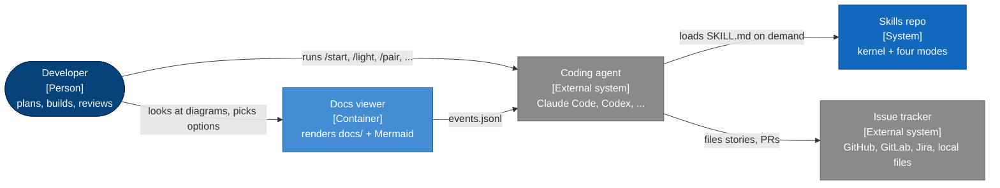

# Skills v2: Requirements

**Status:** agreed
**Date:** 2026-10-13
**Related:** v1.0.0 (the last version built on `mattpocock/skills`), [design.md](design.md), [phases.md](phases.md)

v1 works, but it leans on another repo for its most-used primitives, and the stories it writes read like they were written for the agent rather than for the person who has to look at the result. v2 makes the repo self-contained, organizes it around the four ways I actually work, makes stories something a human can see, and makes pictures a first-class part of every planning artifact.

## Goals

- The repo installs and runs on its own. No skill names, setup steps, or file conventions from another skill repo are required.
- Four modes, each with an obvious entry point: the full loop, the code-along loop, the light loop, and the pairing loop.
- A story is something a person can see change. The agent still gets context-window sized work, but as tasks inside a story, not as the story.
- Every planning artifact can carry a diagram, the diagram is Mermaid in the markdown file itself, and the agent shows diagrams while it interviews.
- The structure leaves room to grow into full SDLC (release, operate, incident, retro) without reshaping the modes.

## Non-goals

- Not a process framework that owns the repo. Skills stay small, readable, and editable.
- No hosted service. The docs viewer is a local script.
- No native Mermaid C4 diagram types. Mermaid marks them experimental, gives them a fixed style, and has no layout control; v2 uses C4 concepts drawn with flowcharts.
- No visual design tooling. Wireframes are low fidelity.
- Gamedev and learning skills keep their behaviour; they only lose their dependency.

## Actors and surfaces

The developer talks to the agent; the agent loads skills; skills write markdown into the developer's repo; the viewer shows that markdown back with the diagrams drawn and sends choices back to the agent.

## Behavioral requirements

**Independence**

- **R1.** The repo shall contain every skill its modes invoke. No skill shall require a skill from another repository.
- **R2.** A `repo-setup` skill shall write one profile, `docs/agents/profile.md`, that every other skill reads for the tracker, docs locations, commands, and diagram settings.
- **R3.** `repo-setup` shall migrate a v1 repo: read `docs/agents/issue-tracker.md` if present, and offer to move glossary terms out of an old-style `CONTEXT.md` into `GLOSSARY.md`.

**Shared spine**

- **R4.** `GLOSSARY.md` shall hold the ubiquitous language. `CONTEXT.md` shall hold the system context: the C4 level 1 picture, the actors, what is outside the boundary, and why the system exists.
- **R5.** ADRs shall live in `docs/adr/NNNN-*.md` in one format shared by all modes.

**Modes**

- **R6.** `/start` shall read the repo state and recommend one mode with a one-line reason.
- **R7.** The full loop shall run align, requirements, design, phasing, stories, build, and re-plan, one artifact per step.
- **R8.** The light loop shall take one change from an interview to a single story to a build, and shall send the user to the full loop when the change carries real design weight.
- **R9.** The code-along loop shall build any story as a lesson the user codes, followed by a debrief.
- **R10.** The pairing loop shall build one slice at a time in steps, with a memory bank that survives `/clear`.
- **R11.** Modes shall call kernel skills and shall not call each other. A user may switch mode per story.

**Stories**

- **R12.** A story shall describe one change a person can see: a scenario, a demo, a picture, and acceptance criteria in the user's words.
- **R13.** A story shall own one or more tasks. A task shall be sized for one agent context window and carry the design detail (interfaces, data, algorithm, sample code, files, TDD plan).
- **R14.** A story title shall use glossary terms a user would say, and shall not name an implementation artifact (table, port, endpoint, adapter, service, schema).
- **R15.** Before the user sees a breakdown, a critic running in a fresh context shall check every story against the story rules and the breakdown shall be revised until it passes.
- **R16.** A change with no possible human demo shall become a task inside the story it enables, or a spike story whose demo is the answer it produces.

**Visuals**

- **R17.** Every diagram shall be a Mermaid block inside the markdown artifact it belongs to.
- **R18.** A notation guide shall map each kind of question to a diagram type and to the artifact it lives in, using C4 levels drawn as flowcharts.
- **R19.** The agent shall validate every Mermaid block it writes and shall be able to render it to an image and look at it before showing it.
- **R20.** The interview shall support a "show, then ask" turn: a diagram of the agent's current understanding followed by one question about what is wrong with it.
- **R21.** A wireframe shall be an HTML mockup sidecar file next to the markdown, with a Mermaid screen-flow diagram as the canonical record that links to it.
- **R22.** A local viewer shall render `docs/`, `CONTEXT.md`, and `GLOSSARY.md` with live reload, show option blocks as choosable cards, show mockup sidecars, and append choices and node comments to an events file the agent reads.

## Non-functional requirements

| Dimension | Requirement |
|---|---|
| Portability | Skills are plain markdown and work in any agent that loads `SKILL.md`. Claude-specific tools are used when present and have a written fallback. |
| Dependencies | The viewer is Python 3 standard library only, loading Mermaid and a markdown renderer from a CDN in the browser. Mermaid validation uses `@mermaid-js/mermaid-cli` through `npx`. |
| Latency | Viewer reload under one second after a file save. |
| Durability | All state lives in git-tracked markdown. The viewer's events file is the only ephemeral state and is safe to delete. |
| Trust boundary | The viewer binds to 127.0.0.1 only and serves files from the repo root. |
| Readability | No skill over roughly 250 lines; detail goes in reference files beside it. |

## Edge cases and failure modes

- **E1.** No tracker configured: everything is a local file (R2).
- **E2.** `mmdc` unavailable (no Node, no network): the agent says so, and still writes the diagram, marked unvalidated (R19).
- **E3.** A story that fails the critic three times: the agent shows the user the critic's objection instead of looping.
- **E4.** v1 artifacts on disk (`docs/planning/*/stories` without tasks): skills read them; new stories are written in the v2 format.
- **E5.** Mattpocock skills still installed alongside: the README names the overlapping skill names and how to remove them.

## Acceptance criteria

- [ ] `grep -ri mattpocock skills/` finds only attribution text (R1).
- [ ] Every `SKILL.md` has valid frontmatter with `name` matching its folder (R1).
- [ ] `/start` in an empty repo recommends a mode (R6).
- [ ] The story format has Scenario, Demo, Picture, Acceptance, and Tasks; the critic checklist rejects an implementation-noun title (R12 to R15).
- [ ] Every Mermaid block in the repo passes the validator (R17, R19).
- [ ] The viewer serves this repo's docs, renders diagrams, and records a choice to the events file (R22).
- [ ] The README shows install and a first session for each mode (R6 to R10).

## Open questions

None open. Viewer ships in the same release as a script inside `visualize`.

## Out of scope (deferred, not rejected)

Release, operate, incident, and retro skills (the next SDLC stages). Native C4 diagram types, if Mermaid stabilizes them. A richer wireframe language.
