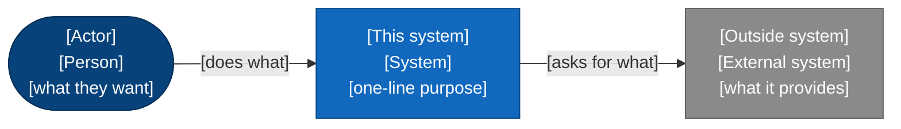
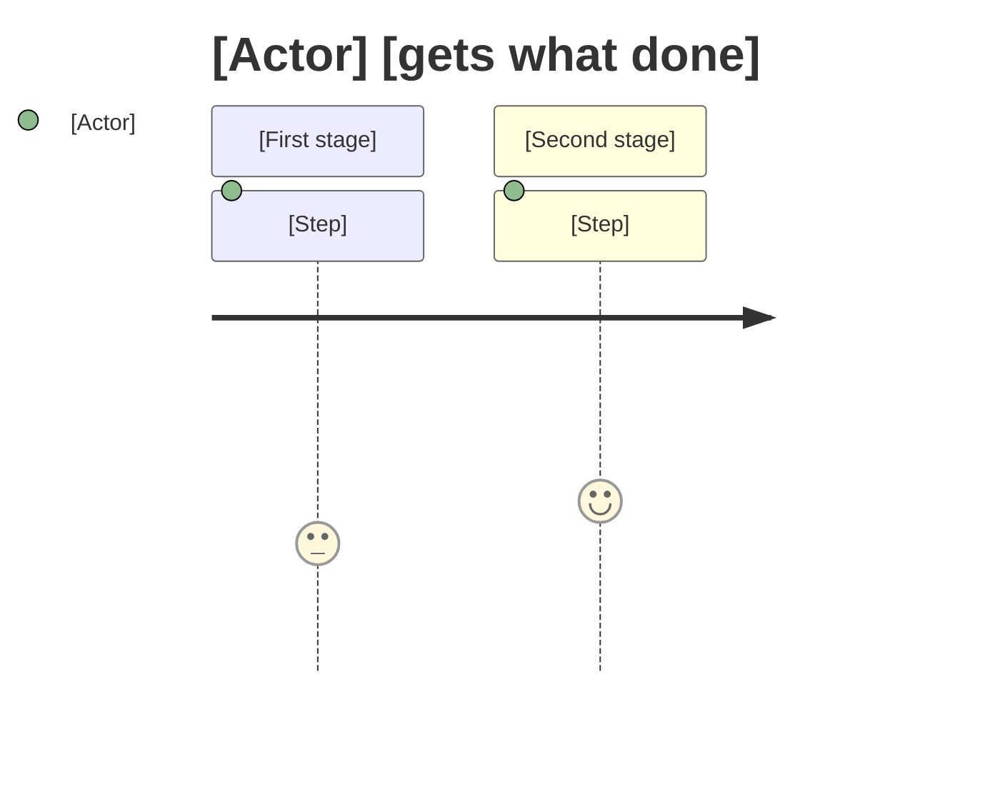

# [Feature / system name]: Requirements

**Status:** Draft | Reviewed | Agreed
**Date:** [date]
**Owner:** [name]
**Related:** [links to the interview findings, ADRs, upstream proposals, IETF drafts]

One paragraph stating what this is and why it exists now. No solution language. If a
reader cannot tell from this paragraph what problem is being solved and for whom,
the rest of the document will not save it.

## Goals

What success looks like, as outcomes, not features. Each goal is a sentence a
stakeholder would agree is worth doing. Three to six of them.

## Non-goals

What this deliberately does not do, and the boundary line for each. This section is
load-bearing. Most thin requirements are thin because the non-goals were never
written down, so scope stayed implicitly infinite. Name the tempting adjacent things
this is not.

## Actors and surfaces

Who or what interacts with this, and through which surface. Be specific about machine
actors as well as humans: an upstream service, a payment provider, an agent, a cron
job, an MCP client. For each, name the surface they touch (CLI, REST, gRPC, MCP,
library API, webhook) and what they are trying to accomplish.

Draw it as a C4 level 1 context diagram (see `visualize` NOTATION.md): people and
outside systems around one box for this system, every arrow labelled with what
crosses it. Follow it with one sentence saying what to look at.

## User journey

The main path a person takes, step by step, as a `journey` diagram (or a screen
flow, with nodes linking to `mockups/*.html`, when the surface is screens). The
phasing step slices this into a story map, and each story lights up part of it.

## Behavioral requirements

The core of the document. Each requirement is a discrete, numbered, testable
statement of behavior. Prefer Given / When / Then where the behavior is conditional.

- **R1.** Given [precondition], when [event], the system shall [observable behavior].
- **R2.** ...

Rules for this section:
- One behavior per requirement. If it has an "and" joining two behaviors, split it.
- State the observable outcome, not the mechanism. Mechanism is the design's job.
- Cover the unhappy paths explicitly. For every R that describes success, ask what
  the failure requirement is and write it as its own R.

## Non-functional requirements

The dimensions that text usually skips and that later cause rewrites. Fill every row
or strike it with a reason. Do not leave a row blank and silent.

- **Latency / timing:** budgets, windows, deadlines. For anything in a call path,
  state the hard window and what happens when it is missed.
- **Throughput / scale:** expected and peak volume, concurrency.
- **Availability:** uptime target, degradation behavior, what "down" means here.
- **Durability / consistency:** what must survive a crash, what may be lost, ordering
  guarantees.
- **Security and trust:** authn, authz, what is a trust boundary, what is attacker
  controlled. Name the threat this must withstand.
- **Privacy and data handling:** what is collected, retention, who can see it.
- **Compliance / standards:** the specifications or regulations that constrain this
  (for example RFC conformance, GDPR, PCI DSS, SOC 2 controls).
- **Operability:** what an operator must be able to see and do at runtime.

## Data

What is stored, its shape at a high level, retention, and multi-tenancy or isolation
rules. Not a schema. Enough that the design knows the persistence obligations.

## Contracts and external dependencies

The interfaces this must honor and the external systems it relies on. For each
dependency, what it provides, what happens when it is unavailable, and whether its
behavior is owned by you or by someone else.

## Edge cases and failure modes

A flat list of the awkward cases that must be handled, separate from the happy-path
requirements above so they are not lost. Race conditions, partial failures, malformed
input, duplicate delivery, clock skew, the second caller, the empty set, the expired
token. Every entry here should map to a behavioral requirement or be promoted into one.

## Acceptance criteria

How "done" is verified, as checkable statements tied to the requirements. Each should
be something a test or a command can confirm, not a feeling.

- [ ] [Criterion mapping to R1, verifiable by a named test or command]
- [ ] ...

## Open questions

Anything unresolved that blocks or shapes the design, with who owns the answer. An
open question is not a failure; an unstated assumption masquerading as a fact is.

## Out of scope (deferred, not rejected)

Things that are coming but not now, with the phase or milestone where they are
expected. This feeds the phasing step directly.
