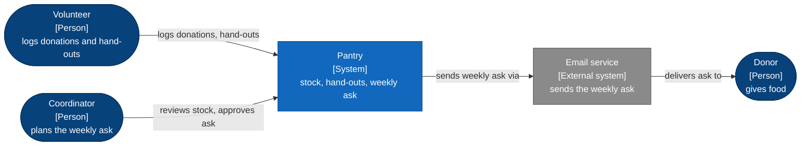

# CONTEXT.md format

`CONTEXT.md` lives at the repo root and holds the system context: why the
system exists, who uses it, what it talks to, and where its boundary is. It is
C4 level 1. It holds no term definitions; those live in `GLOSSARY.md`.

## Structure

````markdown
# <System> context

<One paragraph: why the system exists. The problem, who has it, and what the
system does about it. Plain words, glossary terms.>

```mermaid
<C4 level 1 flowchart: people, the system, external systems, labelled edges>
```

<Caption: one sentence saying what the picture shows.>

## Actors

| Actor | Kind | What they do with the system |
|---|---|---|
| ... | Person / External system | ... |

## Outside the boundary

- <Things people might assume the system does, but it does not; who or what
  does instead.>

## Key constraints

- <Constraints that shape everything: regulatory, platform, performance,
  existing systems that must not change. Link the ADR when one exists.>

## See also

- [GLOSSARY.md](GLOSSARY.md): the words
- [docs/adr](docs/adr/): the decisions
````

## Drawing the C4 level 1 diagram

Use `visualize`'s C4 style (the `visualize` skill's `C4-STYLE.md`): a Mermaid
`flowchart`, never Mermaid's native C4 types. Rules:

- Exactly one node with class `system`: this system. Everything inside it is
  hidden at this level.
- People are stadium nodes `(["..."])` with class `person`.
- Outside systems are rectangles with class `external`.
- Labels follow `Name<br/>[Kind]<br/>purpose`. `Name` is a glossary term or a
  proper noun.
- Every edge has a short verb label in the direction of the main flow.
- About 12 nodes at most. If it is more, group externals.
- Validate with the `visualize` skill's `scripts/mermaid_check.py` when the
  profile has validation on; otherwise add `<!-- unvalidated -->` above the
  block.

## Worked example

````markdown
# Pantry context

Small food banks track donations and hand-outs on paper, so they never know
what is about to run out. Pantry gives volunteers one place to log donations and
hand-outs and tells the coordinator what to ask donors for this week.



Volunteers and the coordinator use Pantry directly; donors only ever see the
email it sends.

## Actors

| Actor | Kind | What they do with the system |
|---|---|---|
| Volunteer | Person | Logs each donation and hand-out at the counter. |
| Coordinator | Person | Reviews stock levels and approves the weekly ask. |
| Donor | Person | Receives the weekly ask by email; never signs in. |
| Email service | External system | Delivers the weekly ask. |

## Outside the boundary

- Recipient eligibility checks: done on paper by the partner agency.
- Donor accounting and tax receipts: the food bank's existing bookkeeping tool.

## Key constraints

- Must run on a shared tablet with patchy Wi-Fi; logging works offline.
- No recipient personal data is stored ([ADR 0002](docs/adr/0002-no-recipient-data.md)).

## See also

- [GLOSSARY.md](GLOSSARY.md): the words
- [docs/adr](docs/adr/): the decisions
````
