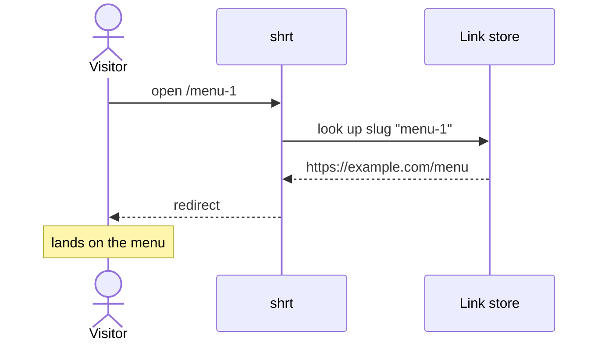

# Story format

One file per story at `docs/planning/<slug>/stories/NN-MM-<slug>.md`, where
`NN` is the phase (`01` when there is no phased design) and `MM` the story's
place in dependency order. On a real tracker the same body becomes the issue
body, without the `Status` line; the tracker holds the state.

The slug comes from the title, so it reads like the title: `02-04-visitor-follows-a-short-link.md`.

## The template

````markdown
# NN-MM: <What a person can now do, in glossary words>

**Status:** ready
**Phase:** <n, name> or none
**Blocked by:** <story ids and titles> or none
**Serves:** R3, R7

## Scenario

<Two sentences. A real person, what they are trying to get done, why it
matters now. Plain words, no jargon.>

## Demo

After this ships, I <open / run / click> ___, <do> ___, and see ___.

## Picture

```mermaid
<one diagram: the journey slice, screen flow, or sequence this story lights up>
```

<One sentence: what to look at in the picture.>

## Acceptance

- [ ] <observable outcome, in the user's words> (R3)
- [ ] ...

## Out of scope

<What this story leaves for later, and which story or phase takes it.>

## Tasks

- [ ] T1: <technical title>
- [ ] T2: <technical title>

### T1: <technical title>

**Design**

<Only the subsections this task needs: interfaces and types, data, algorithm
(numbered steps), sample code (ten to forty lines of the decision-rich core),
files it creates or touches. Mark a decision the design doc did not make with
`(story decision)`.>

**TDD plan**

1. `Subject_Condition_Outcome` at <seam>: what it asserts.
2. ...

**Verify**

```bash
<command>   # expect: ...
```

### T2: <technical title>

...

## Verification

```bash
<the Demo as commands>   # expect: <what the person sees>
<full test command>
```
````

## Status

`ready` → `in-progress` (tdd) or `in-lesson` (code-along) → `done`. A task is
done when its checkbox is ticked, which `tdd` does when the task's tests and
Verify pass.

## Field notes

- **Title.** Starts with the actor or the thing the person now has: "Visitor
  follows a short link," "Owner sees yesterday's sales on the dashboard."
  Never an implementation noun (table, port, adapter, endpoint, service,
  schema, migration, handler, repository).
- **Scenario.** "Maya runs a bakery and shares one link to her menu on three
  social sites. Today she pastes the long URL, and it breaks on two of them."
  A person, a goal, a reason.
- **Demo.** Something a human does and sees. A browser, a CLI command with
  visible output, an email arriving, a file appearing. `go test ./...` is a
  check, not a demo.
- **Picture.** Usually a `journey` slice or a screen flow for user-facing
  stories, a `sequenceDiagram` for stories where the visible change crosses
  several components. Follow `visualize` for the drawing rules.
- **Acceptance.** "Opening a short link in a browser lands on the original
  page." Not "the handler returns 302." The 302 belongs in a task's Verify.
- **Tasks.** The walking skeleton story's T1 usually fixes the contract: the
  interface, the schema, the route table. Later tasks and later stories build
  behind it.
- **As built.** When the code diverges from a task's design, `tdd` or a
  `code-along` debrief appends an `## As built` section saying what changed and
  why.
- **Journal.** `tdd` appends a `## Journal` at the end as it builds: one entry
  per ticked task, plan change, decision, debug, or spike, each with What,
  Why, How, Evidence, and Considered. The `pr` skill writes the PR from it.

## Worked example

````markdown
# 02-04: Visitor follows a short link

**Status:** ready
**Phase:** 2, sharing links
**Blocked by:** 02-01 Owner creates a short link
**Serves:** R4, R9

## Scenario

Maya posted her bakery's short link on three sites. Her customers tap it on
their phones and expect to land on today's menu, not an error page.

## Demo

After this ships, I create a link to `https://example.com/menu`, open
`http://localhost:8080/menu-1` in a browser, and land on the menu page.

## Picture



The visitor never signs in: a short link is the only public way in.

## Acceptance

- [ ] Opening a short link lands on its target page. (R4)
- [ ] Opening a slug nobody created shows "link not found," not a server error. (R9)
- [ ] A visitor needs no account to follow a link. (R9)

## Out of scope

Click counts (02-06) and rate limiting (phase 4).

## Tasks

- [ ] T1: Resolve route for `GET /{slug}`
- [ ] T2: Not-found page for unknown slugs

### T1: Resolve route for `GET /{slug}`

**Design**

Consumes `LinkRepository.FindBySlug(ctx, slug) (Link, error)` from 02-01. Adds
no port. The route sits outside the auth middleware group. Files:
`internal/http/redirect.go`, `internal/http/redirect_test.go`, router wiring in
`internal/http/router.go`.

**TDD plan**

1. `Redirect_KnownSlug_Returns302ToTarget` at the HTTP handler with a fake repo.
2. `Redirect_NoAuthHeader_StillRedirects` at the router.

**Verify**

```bash
go test ./internal/http/ -run Redirect   # expect: ok
```

### T2: Not-found page for unknown slugs

**Design**

`ErrLinkNotFound` from the repo maps to 404 with the plain body `link not
found`. Any other error maps to 500 and is logged with the slug.

**TDD plan**

1. `Redirect_UnknownSlug_Returns404WithMessage` with a fake repo returning `ErrLinkNotFound`.

**Verify**

```bash
go test ./internal/http/ -run Redirect_Unknown   # expect: ok
```

## Verification

```bash
make run &
curl -s -o /dev/null -w '%{http_code} %{redirect_url}\n' localhost:8080/menu-1
# expect: 302 https://example.com/menu
go test ./...
```
````
