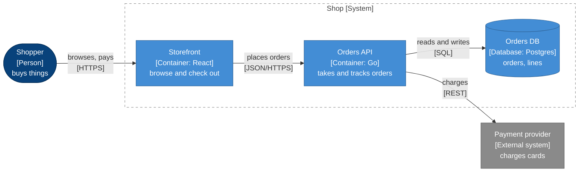

# C4 style

C4 diagrams here are Mermaid flowcharts with one shared set of classes, so a
person is the same dark blue in `CONTEXT.md`, the design, and a story. Copy
this block verbatim to the bottom of every C4 diagram. Use only the classes
the diagram needs; unused `classDef` lines are harmless but noisy, so trim them.

```text
  classDef person fill:#08427b,stroke:#052e56,color:#fff
  classDef system fill:#1168bd,stroke:#0b4884,color:#fff
  classDef container fill:#438dd5,stroke:#2e6295,color:#fff
  classDef component fill:#85bbf0,stroke:#5d82a8,color:#000
  classDef external fill:#8a8a8a,stroke:#5e5e5e,color:#fff
  classDef db fill:#438dd5,stroke:#2e6295,color:#fff
  classDef boundary fill:none,stroke:#8a8a8a,stroke-dasharray:5 5,color:#444
```

| Class | Use for | Shape |
|---|---|---|
| `person` | a human actor | `id(["..."])` stadium |
| `system` | the system in scope at L1 | `id["..."]` box |
| `container` | a deployable or runnable unit at L2 | `id["..."]` box |
| `component` | a module inside one container at L3 | `id["..."]` box |
| `external` | anything you do not build or deploy | `id["..."]` box |
| `db` | a data store, at L2 or L3 | `id[("...")]` cylinder |
| `boundary` | a subgraph drawn as a dashed boundary | `class sub boundary` |

## Node labels

Three lines: name, kind in brackets, purpose.

```text
orders["Orders API<br/>[Container: Go]<br/>takes and tracks orders"]:::container
```

- **Name** is a glossary term, title case.
- **Kind** is `[Person]`, `[System]`, `[External system]`, `[Container: tech]`,
  `[Component: tech]`, or `[Database: tech]`. Tech appears from L2 down.
- **Purpose** is a short verb phrase, lower case, under about 35 characters.

Always quote the label. `<br/>` breaks lines; keep each line under about 30
characters so boxes stay compact.

## Relationship labels

A verb phrase from the source's point of view, quoted, on the edge. At L2 and
below, add the protocol or mechanism in brackets.

```text
web -->|"places orders<br/>[JSON/HTTPS]"| api
api -->|"reads and writes<br/>[SQL]"| db
api -.->|"publishes OrderPlaced<br/>[NATS]"| bus
```

Solid arrows for synchronous calls, dotted (`-.->`) for asynchronous messages.
One arrow per relationship, in the direction of the dependency or data flow,
not both ways.

## Boundaries

A system or deployment boundary is a `subgraph` with a quoted title in the
same label style:

```text
subgraph shop["Shop [System]"]
  web
  api
  db
end
class shop boundary
```

Nodes outside the subgraph are outside the boundary. Give the subgraph an id
so edges and `class` can reference it.

Do not put a `direction` line inside a boundary subgraph whose nodes have
edges to the outside. Mermaid then lays the subgraph out as one block and
clips those edges at its border, so the reader cannot see which container a
call lands on. Steer layout with the outer `flowchart LR` or `TB` and the
order you declare nodes in instead.

## Legend as footnote

Mermaid flowcharts have no legend. Write one as a single line of text directly
under the caption, only for the classes the diagram uses:

```markdown
_Key: dark blue stadium = person; blue = our containers; light blue = component;
grey = external; cylinder = data store; dotted arrow = async message._
```

Leave it off diagrams whose readers already know the key (a second C4 diagram
in the same file).

## Full example



Everything the shop runs sits inside the dashed boundary; the card charge is
the one call that leaves it.

_Key: dark blue stadium = person; blue = our containers; grey = external;
cylinder = data store._
