# Notation

Start from the question the reader is asking. The question picks the diagram,
and the diagram has a home artifact where it lives.

| Question | Diagram | Lives in |
|---|---|---|
| Who uses it, what is outside | C4 L1 context: flowchart, person and system classes | `CONTEXT.md`, requirements |
| What the user goes through | `journey` | requirements, phases (story map) |
| Which screens in which order | flowchart screen flow, nodes link to mockups | requirements, stories |
| What the deployables are | C4 L2 containers: flowchart with subgraphs | design |
| What is inside one container | C4 L3 components: flowchart | design (only when needed) |
| How a request flows | `sequenceDiagram` | design, story Picture, task |
| What states it can be in | `stateDiagram-v2` | design, task |
| What the data is | `erDiagram`; `classDiagram` for ports and domain types, sparingly | design, task |
| Which option and why | two or three small diagrams side by side in an options block | interview, ADR |
| What this change did | one diagram of the type that fits (see the `pr` skill) | PR body |

## C4 in one paragraph

C4 zooms in on a system in levels. **L1 context**: the system as one box, the
people who use it, and the systems outside it. **L2 containers**: the things
you deploy or run (web app, API, database, queue, worker) and how they talk.
**L3 components**: the modules inside one container. **L4 code** is the code
itself; do not draw it. Most work needs L1 once (in `CONTEXT.md`) and L2 once
(in the design). Draw L3 only for the container a design actually changes.

## Why flowcharts, not Mermaid's C4 types

Mermaid has `C4Context` and friends, but they are marked experimental, their
styling is fixed, their layout cannot be steered (no direction, no layout
statements, boxes land where they land), and they have no legend or tag
support worth using. Flowcharts render everywhere, take `direction`,
subgraphs, and `classDef`, and diff cleanly. The shared classes and label
convention are in [C4-STYLE.md](C4-STYLE.md).

## UML: what is worth drawing here

- **Sequence diagram.** Yes. The best picture for a request crossing
  components, retries, and who waits on whom.
- **State diagram.** Yes. Any entity with a status field gets one before its
  transitions are coded.
- **Class diagram.** Sparingly. For ports (interfaces) and the few domain
  types they pass, not for every struct. Data shape goes in an ER diagram.
- **Activity diagram.** Draw it as a flowchart with decision diamonds; Mermaid
  has no activity type and a flowchart reads the same.
- **Skip:** use case diagrams (a journey or C4 L1 says more), component and
  deployment diagrams (C4 L2 and L3 replace them), object, package, timing,
  communication, and interaction overview diagrams.

## Examples

Short ids, glossary terms as labels, one caption sentence after each.

### C4 L1 context

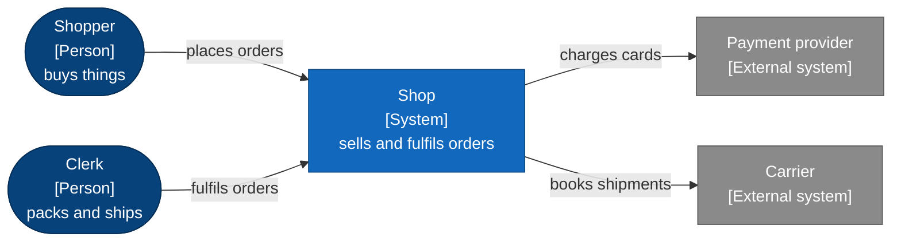

Two people use the shop; money and parcels are the two things we hand to
someone else.

### Journey

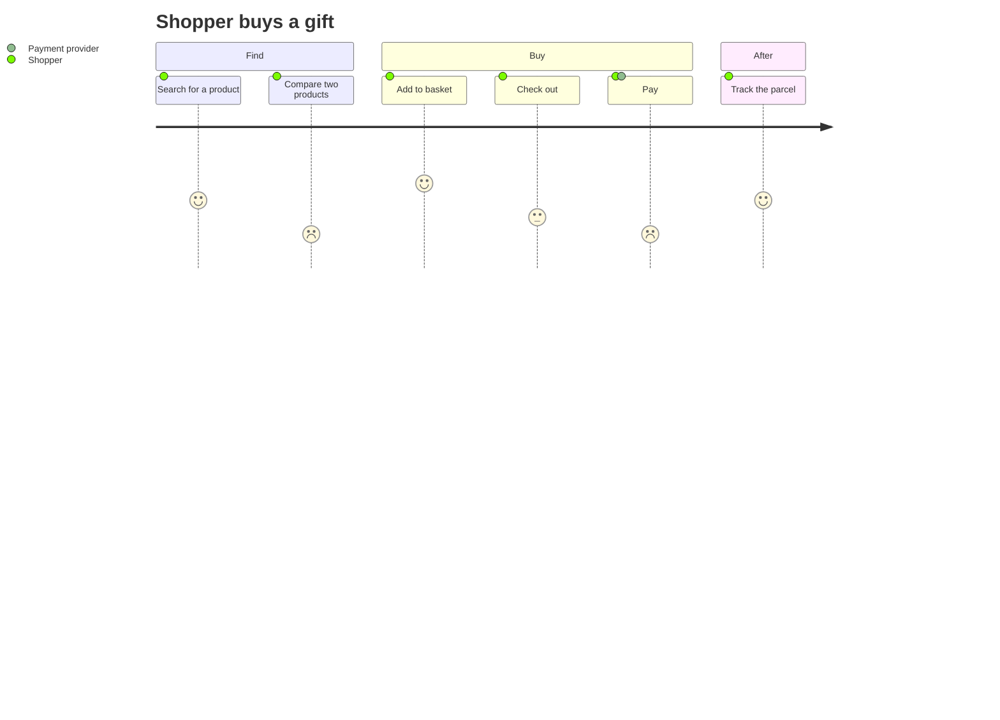

Comparing and paying score lowest, so those are the stories to slice first.

### Screen flow, linked to mockups

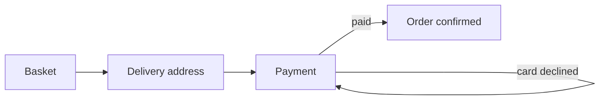

A declined card returns to Payment, not to the Basket; each box opens its
mockup.

### C4 L2 containers

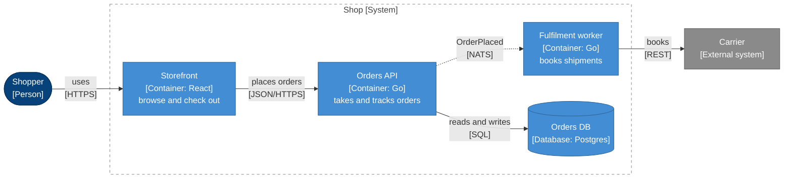

The Orders API never calls the carrier; the dotted message to the worker is
the only bridge.

### C4 L3 components

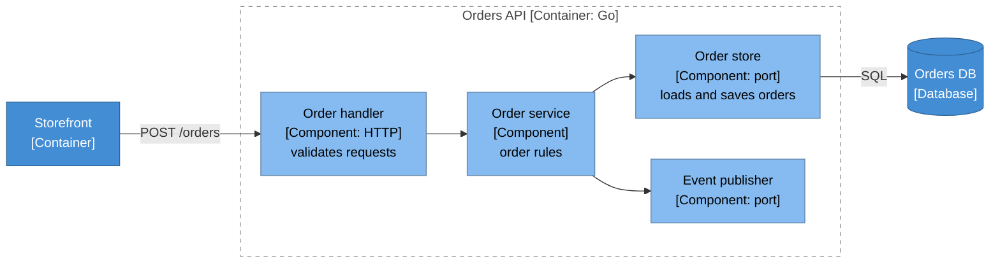

The order rules depend on two ports and nothing else, which is what makes
them testable without a database.

### Sequence

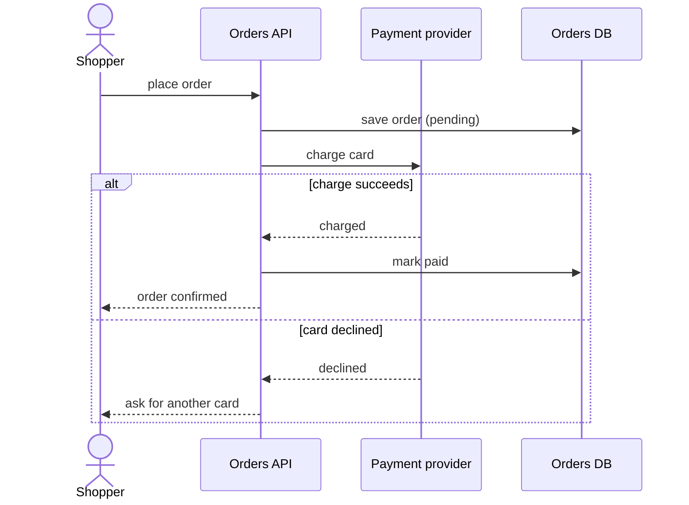

The order is saved before the charge, so a crash mid-charge leaves a pending
order to reconcile, never a charge with no order.

### State

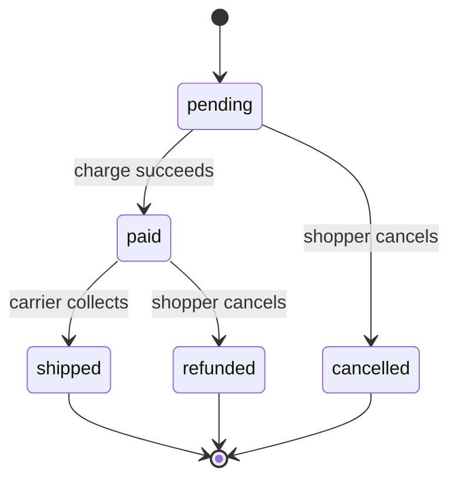

Cancelling means two different things depending on whether money has moved.

### Data (ER)

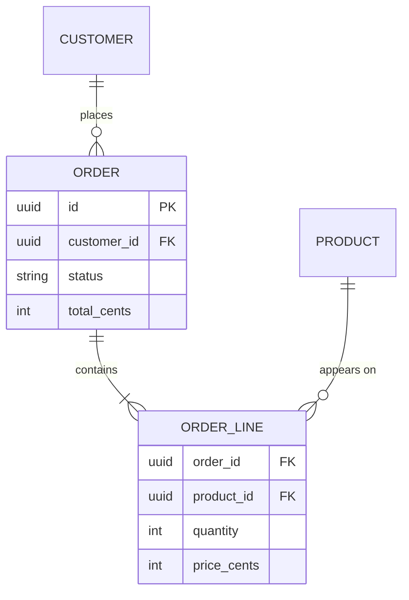

The line keeps its own price, so changing a product's price never rewrites an
old order.

### Ports (class diagram, sparingly)

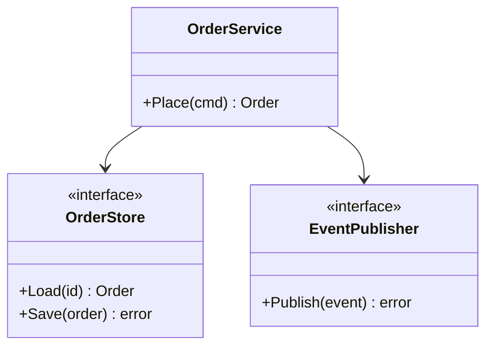

Two ports, both owned by the service; adapters implement them, nothing else
does.

### Options pair

Inside an options block (see [SKILL.md](SKILL.md) step 5), each option gets a
diagram at the same zoom with the same ids for shared things:

````markdown
<!-- options: order-events -->
### Option A: API publishes directly
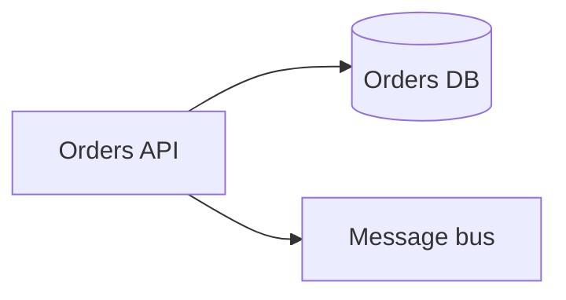
Simple; an event can be lost if the API dies between the save and the publish.

### Option B: outbox table
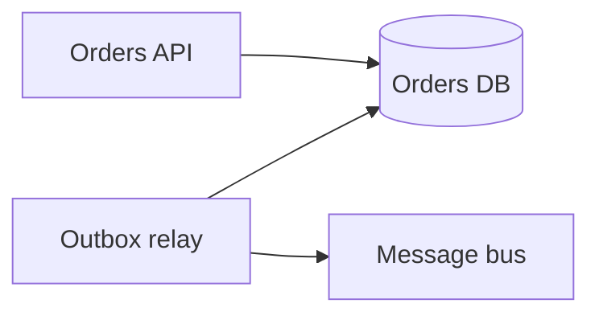
No lost events; one more process to run.
<!-- /options -->
````

### Before and after

One diagram, changed parts marked with a class, for a PR body:

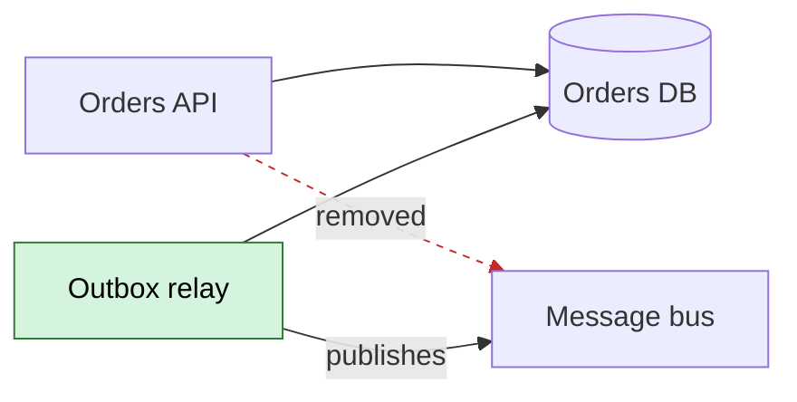

The API no longer talks to the bus; the new relay (green) does.
