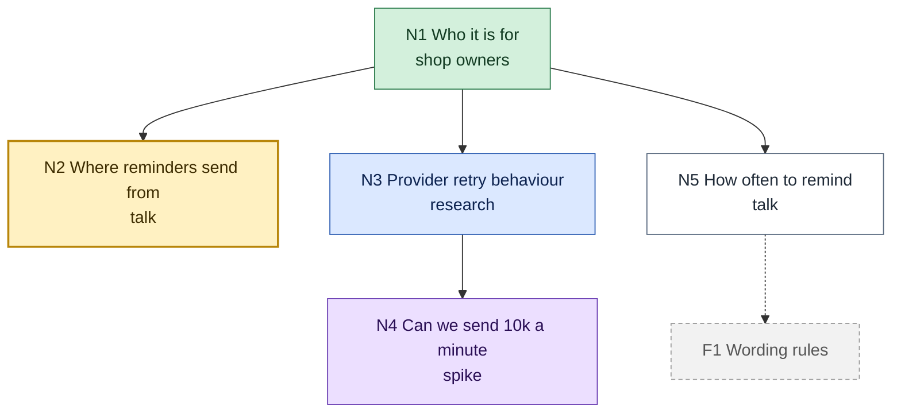

# Trail map format

A trail is a folder:

```text
docs/research/<topic>/
  map.md                  the index and the picture
  nodes/N<k>-<slug>.md    one per node
  findings/<slug>.md      research notes
  spikes/<slug>.md        spike briefs
  prototypes/<slug>.html  prototypes
  asks/<slug>.md          questionnaires for other people
  report.md               written on arrival
```

Node ids are `N1`, `N2`, ... in creation order, never reused, and are also the
Mermaid node ids, so a diff of the map shows exactly which node changed.

## map.md

````markdown
# <Topic>: Trail map

**Status:** exploring | arrived | parked
**Started:** <date>   **Last session:** <date>

## Destination

<What arriving looks like, one or two lines. Its type: decision, spec, change,
recommendation, or understanding.>

## Anti-goals

- <What this trail refuses to build or decide, and why.>

## The map



White: open, not started. Yellow: the question now. Blue: an agent is
reading. Purple: a spike or prototype is running. Green: decided. Grey dashed:
fog. Red dashed: out of scope. Arrows point from a node to the nodes that
depend on it.

## Frontier

Open nodes whose dependencies are all decided. Only these are offered.

| Node | Kind | Why it matters |
|---|---|---|
| [N2 Where reminders send from](nodes/N2-where-reminders-send-from.md) | talk | decides the provider shortlist |
| [N5 How often to remind](nodes/N5-how-often-to-remind.md) | talk | sets the tone of the whole feature |

## Waiting

Nodes blocked on another node, a running agent, or a person.

| Node | Kind | Waiting on |
|---|---|---|
| [N4 Can we send 10k a minute](nodes/N4-can-we-send-10k-a-minute.md) | spike | N3 (research, running) |

## Decisions so far

- [N1 Who it is for](nodes/N1-who-it-is-for.md): shop owners with under 500 open invoices.

## Assumptions

| Id | Assumption | Risk if wrong | Checked by |
|---|---|---|---|
| A1 | Owners already have customer emails | the feature needs an import step first | N6 (research) |

## Fog

- **F1 Wording rules**: <a suspected question you cannot phrase sharply yet,
  as loose as the view allows; what it hangs on>.

## Out of scope

- <What was ruled out, why, and the node it came from if any.>

## Terms in play

- <Words used on this trail that are not settled yet. Settled ones go to
  GLOSSARY.md and leave this list.>

## Session log

- <date>: <what moved; what is still running in the background; recommended next node>
````

### Drawing rules

- Labels are `N<k> <short question or answer>` and a second line with the kind
  while open, or a two-to-five-word gist once decided.
- Arrows mean "depends on", from prerequisite to dependent. Dotted arrows lead
  into fog.
- One class per node, from the seven above. Paste the `classDef` lines unchanged.
- **Fog is drawn one way.** Each Fog bullet has an `F<k>` id and appears on the
  map as a grey node with that id and no file, reached by a dotted arrow from
  what it hangs on. When it can be phrased as a question, it graduates: a new
  `N<k>` node with a file, and the bullet and the grey node go. A sharp
  question that is merely blocked is never fog; it is an open node in Waiting.
- **Out of scope** nodes keep their `N<k>` id and turn red dashed; a thing ruled
  out before it was ever a node is only a bullet in Out of scope.
- `click` lines link nodes to their files, so the viewer and GitHub both
  navigate.
- **Collapse past about fifteen nodes.** Replace a fully decided subtree with
  one green node, `N3["Storage<br/>3 decisions"]:::decided`, linked to the first
  node of the subtree. The node files keep everything.
- Validate with the `visualize` skill's `scripts/mermaid_check.py` after every
  redraw.

## Node file: nodes/N<k>-<slug>.md

```markdown
# N<k>: <The question>

**Kind:** talk | research | spike | prototype | ask | task
**State:** open | active | researching | probing | decided | out
(the same names as the map's classes; fog patches have no node file)
**Depends on:** N1, N3   **Opened by:** N1

## Why it matters

<The decision or destination this unblocks, in one or two lines.>

## Evidence

- <Fact.> (**ran it**: [spike brief](../spikes/x.md))
- <Fact.> (**cited**: [findings](../findings/y.md))
- <Fact.> (**inferred** from the two above)
- <Belief nobody checked.> (**assumed**, see A2)

## Options

<!-- options: n<k>-options -->
### Option A: <name>
<small diagram>
Gains: ... Gives up: ...

### Option B: <name>
<small diagram>
Gains: ... Gives up: ...
<!-- /options -->

## Decision

<What was decided, by whom ("the user", or "delegated to the agent"), on what
date, why, and what it rules out. The chosen option's diagram moves here and the
options block is removed. Link the ADR if one was written.>

## Opens

- <Nodes this decision created, linked.>
```

Omit sections that do not apply yet. A research or spike node's Decision is
usually "settled by evidence": the answer, its strength, and the link.

## Evidence words

Every fact in a node file carries one of these. Other skills use their own
words; this table maps them.

| Word | Means | Comes from |
|---|---|---|
| **ran it** | We executed something and saw the result. | A spike verdict of Confirmed or Rejected; what a prototype showed when clicked. |
| **cited** | A primary source says so, linked. | `research` findings marked cited; an `ask` reply (the person and date are the source). |
| **inferred** | Reasoned from facts above, with the reasoning shown. | `research` findings marked inferred. |
| **assumed** | Nobody checked. Listed in the map's Assumptions with its risk. | A `research` "unknown"; the conditions of a Partial spike; anything said in passing. |
| **user chose** | Not evidence: the user's decision. Goes in Decision, never Evidence. | A talk answer; a prototype pick. |

A `research` **conflict** (sources disagree) is not settled by picking one:
record both as cited and open a talk node, or a spike if running it would settle
it. A **Partial** spike is recorded as ran it for what worked, plus an assumption
for each condition it depends on.

## report.md

Written on arrival, or on parking (then marked partial: what is decided, what is
open, what was still running, and how to resume).

```markdown
# <Topic>: Trail report

**Arrived:** <date> (or **Parked, partial:** <date>)   **Destination:** <as written in the map>

## The answer

<The destination reached, in one paragraph a newcomer understands.>

## The picture

<The one diagram that best shows the outcome: the chosen design, the flow, the
context. Not the trail map.>

## The route

<The decisions in the order they were made, one line each, linked to node
files and ADRs.>

## Evidence

<The findings, spikes, and prototypes the route rests on, linked, with their
verdicts.>

## Open risks and assumptions

<What is still assumed, what was parked, and what would change the answer.>

## Next

<The recommended next skill and what to point it at.>
```
