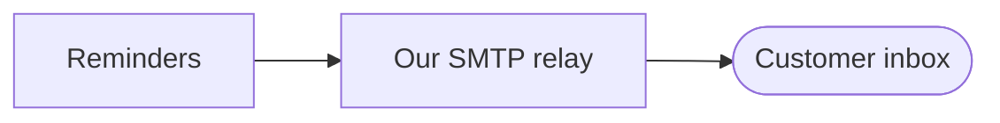
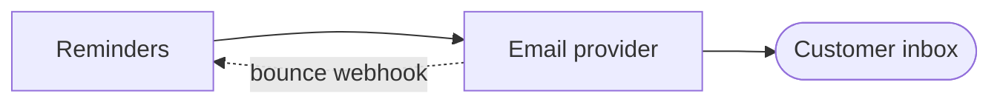

# Working nodes

Each node has a kind, and the kind decides how it is settled. The test is who or
what holds the answer.

| Kind | Holds the answer | Tool | Runs |
|---|---|---|---|
| talk | the user's judgement | an `interview` turn | with the user |
| research | something written down | `research` | in the background |
| spike | the real system, when run | `spike` | in the background, framed with the user |
| prototype | the user's reaction to something concrete | `prototype` | with the user |
| ask | someone who is not here | a questionnaire | waits for their reply |
| task | nobody yet: setup is in the way | do it, or a checklist | either |

A node can change kind. A talk node that turns out to rest on an unchecked fact
pauses while a research node is opened beneath it.

## talk

Use `interview`'s turn anatomy and nothing else from it (its note on trails
says why): one headline question, your recommendation, the reasoning and
tradeoff, the soft spot as one sentence inside the recommendation, and the
explicit decision you want. About 150 words of prose, plus diagrams. Write the
turn's diagrams and options into the node file too, so the viewer shows them.

Three turn shapes, picked by the question:

**The fork.** Two or three structurally different options. Show them as an
options block (MAP-FORMAT.md) with one small diagram each, a line of gains and a
line of what it gives up, then the recommendation. When the smallest thing that
could work, or not building it, is a real contender, name it in one line under
the block; do not draw a fourth option. When the viewer is running,
the user can click Choose; read `.viewer/events.jsonl` and let the chat answer
win on conflict.

````markdown
<!-- options: n2-send-path -->
### Option A: send from our server

Gains: no new vendor. Gives up: deliverability is our problem.

### Option B: send through a provider

Gains: deliverability and bounce data. Gives up: a vendor and a webhook to handle.
<!-- /options -->
````

**Show, then ask.** When the subject is structural and your understanding is
shaky, draw what you think and ask only "what is wrong with this picture?" with
where you are least sure.

**The open question.** When there is no structure yet ("why does this matter
now"), ask plainly, with your best guess as the recommendation.

Never stack questions. If the answer opens three more, they become nodes and the
user picks among them later. A fuzzy word in the answer goes on Terms in play,
not into a glossary detour, unless this decision depends on it.

## research

Write the brief per the `research` skill, aimed at the node's question, with the
output at `findings/<slug>.md`. If the answer depends on something only the user
knows (which country, which plan tier), put it in the brief as an assumption to
confirm, and add that assumption to the map. Start it in the background (at most
three running; the rest wait, marked "queued"), mark the node blue, and keep
talking about something else. With no sub-agent tool, research it between turns
and keep it short. When it lands, write its one-line answer
into the node's Evidence as **cited**, mention it in the next playback, and if it
created a choice, open a talk node for it.

If the findings say "unknown, a spike would settle it," open a spike node.

## spike

Frame it with the user in one turn: question, hypothesis, pass, fail, timebox,
per the `spike` skill. Once the frame is agreed, run it in the background with
the brief at `spikes/<slug>.md`. With no sub-agent tool, ask whether to run it
now (it takes the whole timebox) or at the end of the session. Mark the node purple. When it lands, its verdict
is evidence of strength **ran it**, and it often retires an assumption from the
map's Assumptions table.

Recommend a spike when the riskiest assumption on the map is a technical one.

## prototype

Use when the talk is going in circles over how something should look or
behave, or the user says "show me." Per the `prototype` skill: state the
question, pick LOGIC, UI, or FLOW, build it at `prototypes/<slug>.html`, open it
through the viewer if it is running. Mark the node purple while the user plays
with it. Their pick and notes arrive as `prototype` events or in chat. The
decision is written back into the node file as Mermaid (a state diagram, a
sequence, or a screen flow) and the HTML stays linked as the record.

## ask

Someone else holds the answer: a domain expert, a customer, ops, legal. Write
`asks/<slug>.md` for that person, not for the agent:

```markdown
# Question for <person or role>

**From:** <user> via the <topic> trail   **Needed by:** <date, or "before we decide N4">

<Two or three sentences of context they need, in their words, no jargon.>

<One diagram if it saves them reading.>

**The question:** <one question>

**Options we are weighing:** <each in a line, or "open">

**What we will do with your answer:** <one line>
```

The node moves to the map's **Waiting** table as "waiting on <person>". When the
user pastes the reply, record it as evidence (**cited**, the person and date)
and move the node back to the Frontier to decide.

## task

Something has to be done before the question can even be looked at: get an API
key, export a sample of real data, get access to a dashboard. Do it yourself when
you can. Otherwise give the user a precise checklist, one action per line, with
what to paste back. Record the resulting facts (where the credentials live, the
row count, the payload sample's path) in the node; later nodes depend on them.

## Recommending the next node

Only Frontier nodes are offered: open, with every dependency decided. Score
each, roughly:

- **Risk if wrong:** would a wrong answer here waste most of the work downstream?
- **Uncertainty:** do we have no idea, or a strong guess?
- **Unblocks:** how many nodes are waiting on it?

Recommend the top two or three with one line each on why now. Prefer the node
that checks the riskiest assumption. Mention any background result that changes
the ranking.

## The playback

After every user decision, and at the start of every resumed session. Never
for a background result on its own.

```markdown
**Where we are.** <What was decided and why, in a sentence or two. What came back
from background agents and what it changes. How far we are from the destination,
in plain words.> (150 words at most)

<The redrawn map, or "the map is updated in the viewer.">

**Next?**
- **N4 Can we send 10k a minute** (spike): the riskiest assumption left; if it
  fails, the provider choice changes.
- **N6 Do owners have emails** (research): cheap, and two nodes wait on it.

Which one?
```
