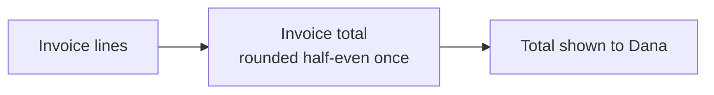

# Memory bank

Everything a fresh session needs to resume pairing, in the repo, committed with
the code it describes. Each file has one job and one writer pattern; keep each
meaning in exactly one place.

```
docs/pairing/
  WORKING-AGREEMENT.md   pair-setup. Stack, commands, style, git flow, pairing
                         preferences. Outranks every pair-* skill.
  STATE.md               "You are here." Overwritten, never appended. Short.
  ROADMAP.md             Sources, the pieces carved from them, spec drift.
  sources/NNNN-*.md      Pasted or out-of-repo specs, copied verbatim.
  slices/NNNN-<slug>.md  One per piece: scenario, demo, picture, goal,
                         acceptance, plan, journal.
  slices/NNNN-<slug>.pr.md  Local mode only: the PR body, when there is no
                         remote to open a PR on.
GLOSSARY.md              glossary skill. The language: terms, definitions,
                         _Avoid_ words.
CONTEXT.md               glossary skill. System context: the C4 level 1
                         picture, actors, what is outside, why it exists.
docs/adr/NNNN-*.md       glossary skill's ADR format. Hard-to-reverse decisions.
docs/agents/profile.md   repo-setup. Tracker, docs paths, commands, diagram
                         settings. The agreement builds on it.
docs/detours/NNNN-*.md   detour skill. A gap taken to a clean context; the
                         answer comes back in its Return section.
CLAUDE.md                A short "## Pairing" block pointing here.
```

Create files lazily, when there is something to put in them. Every memory bank
change rides in a commit on the slice branch, so `main` only ever receives the
memory bank through a merged PR. One consequence: the copy on `main` always
describes the moment the last PR merged. `pair` therefore trusts the PR state
(from `gh`) over `STATE.md` whenever the two disagree, and the next slice's
first commit brings the memory bank up to date.

**Base.** A slice's `base` is the commit it diverges from. After updating the
branch from the default branch, set `base` to `git merge-base <default> HEAD`.
When in doubt, compute that instead of trusting the field; every
`<base>..HEAD` in these skills means it.

## STATE.md

Overwrite the whole file each time. Stay under 40 lines; history belongs in the
journal and in git.

```markdown
# Pairing state

Updated: 2026-10-08 14:10 by pair-checkpoint

## Active slice
0003 Invoice totals: docs/pairing/slices/0003-invoice-totals.md
Branch: feat/0003-invoice-totals
PR: none            # or: #42 open, 1 review round, CI green
Phase: building     # idle | building | shipping | in-review | merging

## Where we are
Last step: 4 of 6, "round totals half-even," green, committed.
Next step: 5, "reject negative quantities," test first, ping-pong.
Tests at HEAD: green    # or: red, and why (wip checkpoint)

## Open threads
- Is a zero-quantity line an error or a no-op? Waiting on the user.
- Detour 0002 out (teach-me): how cancellation reaches a blocked read.
  docs/detours/0002-context-cancellation.md
- Uncommitted work: none

## Recently shipped
- 0002 Invoice model, #41, merged 2026-10-07
```

Who sets each phase: `pair-slice` sets `building`; `pair-ship` sets `shipping`
at preflight, `in-review` when the PR opens, and `merging` in its close-out
commit just before the merge; the next `pair-slice` turns a merged `merging`
into `idle` history. `pair-checkpoint` sets `idle` when it parks a slice. With
no active slice, the `Active slice` and `Where we are` sections say `none`, and
`Next step` names the next roadmap piece if one is agreed.

## ROADMAP.md

```markdown
# Roadmap

## Sources
- S1: docs/specs/invoicing.md (lives in the repo, user-owned)
- S2: docs/pairing/sources/0002-reminders.md (pasted 2026-10-07)

## Pieces
| Slice | Piece | Source | Status | PR |
|---|---|---|---|---|
| 0001 | Walking skeleton | S1 §1 | merged | #40 |
| 0002 | Invoice model | S1 §3.1 | merged | #41 |
| 0003 | Invoice totals | S1 §3.2 | building | |
| | Late fees | S1 §3.4 | later | |

## Drift
- 2026-10-08, S1 §3.2 says round half-up; we agreed half-even (ADR 0004).
  Spec not updated yet.
```

Status values: `later`, `next`, `building`, `shipping`, `in-review`,
`merging`, `merged`, `parked`, `dropped`. A `later` row has no slice number
until it is carved. The roadmap is a list of candidates, not a plan; rows are
added when the user names a piece or work spills out of a slice.

## Slice file

````markdown
---
slice: 0003
title: Invoice totals
status: building        # building | shipping | in-review | merging | merged | parked | dropped
branch: feat/0003-invoice-totals
base: 9c41e07           # merge base with main; updated after each update from main
source: S1 §3.2
adrs: [0002, 0004]      # ADRs this slice must respect or created
pr:                     # number or URL once opened
started: 2026-10-08
---

# 0003 Invoice totals

## Scenario
Dana, who bills clients monthly, sends an invoice and needs the total to match
the spec's worked example to the cent, or the client disputes it.

## Demo
After this merges, I run `invoice show examples/s1-3-2.json` and see the
total 10.00, matching S1 §3.2.

## Picture

Lines add up exactly; rounding happens once, on the total.

## Goal
One to three sentences, in the user's words where possible: what will be true
when this merges, and which part of the spec it serves.

## Scope
In: line totals, invoice total, rounding.
Out: tax (later piece), currency conversion (not in the spec).

## Acceptance
- [ ] A1. A three-line invoice totals to the sum of its lines, in cents.
      Check: `go test ./invoice -run TestTotal`
- [ ] A2. Halves round to even. Check: the table test in totals_test.go

## Plan
- [x] 1. Line total as integer cents (driver)
- [x] 2. Invoice total sums lines (ping-pong)
- [ ] 3. Half-even rounding
- [ ] 4. Reject negative quantities

## Parked
- The Money type wants a String method; not needed by this slice.

## Drift
- None yet.

## Journal
(entries, oldest first)
````

The header (`Scenario`, `Demo`, `Picture`) follows the `story` skill's format
(the `story` skill's `FORMAT.md`): a real person and their reason, something a
person does and sees, and one Mermaid diagram of the user-visible slice drawn
via `visualize`. It is written for a human; the rest of the file is for the
pair. A slice has no `Tasks` section: plan steps play that role, and they are
smaller than story tasks. Acceptance lines are observable and each names its
check. The plan has three to eight steps, step 1 tiny; it is rewritten freely
as we learn, and the journal records why it changed. Slice files written
before the header existed are read as they are.

## Journal entries

Append-only, oldest first, written in the moment. The journal is the raw
material of the PR's rationale section, so write for a reviewer who was not
there: the why, the alternatives, the dead ends.

```markdown
### 2026-10-08 Step 3: Half-even rounding (navigator)
**What:** totals now round half-even at the invoice level, not per line.
**Why:** per-line rounding drifted by a cent on the S1 §3.2 example; the
spec's worked example only matches when rounding once at the end.
**How:** `Total()` sums exact sub-cent amounts, then calls `roundHalfEven`.
**Evidence:** `TestTotal/halves` red (got 1001, want 1000), then green.
**Considered:** per-line rounding (drifts), a decimal library (blocked by the
dependency policy in the working agreement).
```

An entry never records its own commit hash (it is written before the commit
exists). The `pr` skill maps entries to commits from `git log` when it writes
the PR.

Entry kinds, in the heading after the date:

- `Step N: <title> (<mode>)`: a plan step. Mode records who wrote it.
- `Debug: <symptom>`: hypotheses tried, which held, how it was found.
- `Decision: <title>`: a choice made between steps; link the ADR if one was
  written.
- `Plan change`: steps added, split, dropped, and why.
- `User-coded`: work the user did outside a session, found by `pair` on
  resume; record what changed and the reason the user gave.
- `Review round N`: `Reviewed: <head sha>`, the depth, then findings from pair-ship with
  the tag and disposition of each.
- `Session start` / `Session end`: one or two lines; the end entry says what
  was in flight and what was in the user's head.
- `Parked` / `Unparked`: why the slice stopped, and what it resumes with.

Keep `Evidence` to trimmed real output or the exact command and its verdict.
Never paste secrets; write `<REDACTED>`.
